# BÁO CÁO KIỂM TRA API & LUỒNG NGHIỆP VỤ
## Hệ thống Quản lý Phòng khám (Clinic Management System)

> **Ngày kiểm tra:** 26/10/2026  
> **Phạm vi:** 7 phân hệ theo yêu cầu + toàn bộ router hiện có  
> **Nguồn kiểm tra:** `backend/src/routers`, `middlewares`, `controllers`, `services`, `validators`, `prisma/schema.prisma`, 2 file SQL trigger  
> **Cách đọc:** Mỗi phân hệ gồm 3 phần: (1) bảng endpoint thực tế, (2) sơ đồ sequence, (3) nhận xét & lỗ hổng.

> **Cập nhật 27/10/2026:** Đây là báo cáo **ảnh chụp trước khi khắc phục**. Một số kết luận bên dưới không còn đúng: 5 route hở RBAC đã được đóng; auth đã có refresh/logout/đổi mật khẩu/quên mật khẩu/quản lý tài khoản; lịch hẹn đã có slot 30 phút, chống trùng bác sĩ + bệnh nhân, check-in/hàng chờ; hóa đơn có trigger trong migration, `by-exam`, hoàn tiền; thống kê đã lọc ngày và trừ hoàn tiền. Trạng thái thực tế và 7 sơ đồ E2E xem `KE_HOACH_KHAC_PHUC_THIEU_XOT.md`, mục **0.5**.

> **Trạng thái cập nhật 30/10/2026 — chỉ trong phạm vi 7 nhóm chức năng đã yêu cầu:**  
> Bảng dưới đây là nguồn trạng thái hiện tại. Bảng TL;DR và các mục 10, 11 bên dưới vẫn là ảnh chụp cũ ngày 26/10, dùng để đối chiếu lịch sử, **không dùng để kết luận hiện trạng**.

### 0.1. Các chức năng đã yêu cầu cập nhật

| # | Nhóm chức năng | Trạng thái | Endpoint / bằng chứng | Ghi chú |
|---|----------------|------------|-----------------------|---------|
| 1 | Auth: refresh, logout, đổi mật khẩu, quên/reset mật khẩu, quản lý tài khoản | ✅ Đã có | `POST /api/auth/refresh`, `/logout`, `/forgot-password`, `/reset-password`; `PUT /api/auth/me/password`; `GET/POST /api/auth/accounts`; `PATCH /api/auth/accounts/:id/status`; `POST /api/auth/accounts/:id/reset-password` | OTP hiện là luồng dev; **không gửi SMS/Email thật** theo yêu cầu |
| 2 | RBAC 5 vai trò, đóng 5 route hở | ✅ Đã có | `roleMiddleware` trong `appointment.router.js`, `invoice.router.js` và các router còn lại | YTa không có quyền sửa/hủy lịch; bệnh nhân chỉ thao tác dữ liệu của mình |
| 3 | Tạo bệnh nhân walk-in tại quầy | ✅ Đã có | `POST /api/patients` — Admin, LeTan | Không cần tạo tài khoản trước |
| 4 | Lịch hẹn: slot 30 phút, chống trùng, check-in, hàng chờ, lý do hủy, state machine | ✅ Đã có | `GET /api/appointments/available-slots`; `PATCH /api/appointments/:id/check-in`; `GET /api/appointments/queue`; `PUT /api/appointments/:id/cancel` | Chặn trùng cả bác sĩ và bệnh nhân; 2 request đồng thời chỉ 1 thành công |
| 5 | Hóa đơn: theo lần khám, thanh toán, hoàn tiền, trigger tính tiền | ✅ Đã có | `GET /api/invoices/by-exam/:malsk`; `PUT /api/invoices/:id/pay`; `POST /api/invoices/:id/refund`; trigger `trg_cthd_update_tongtien` | Giá dịch vụ/thuốc lấy từ server; `ngaythanhtoan` được lưu |
| 6 | Thống kê: lọc ngày, trừ hoàn tiền, bệnh nhân, doanh thu theo khoa/bác sĩ, CSV | ✅ Đã có | `/api/statistics/patients`, `/revenue-by-specialty`, `/revenue-by-doctor`, `/export/revenue` | `revenue` trả thêm `tong_hoantien`, `tong_doanhthu` |
| 7 | Hạ tầng DB: migration, trigger, unique index, health check | ✅ Đã có | `prisma/migrations`; `GET /api/health/db` | Đã test trên clone DB cũ và DB mới; **chưa chạy trên Supabase thật** |

**Chưa làm trong phạm vi đã nêu:** đổi vai trò tài khoản (`PATCH /api/auth/accounts/:id/role`), API đọc audit log (`GET /api/audit-logs`), UAT, OpenAPI/Swagger đầy đủ. OTP SMS/Email thật, in hóa đơn PDF và BHYT đã được loại khỏi phạm vi theo yêu cầu.

---

## 0. KẾT LUẬN NHANH (TL;DR — ẢNH CHỤP 26/10)

| # | Chức năng | Mức độ | Thiếu endpoint? |
|---|-----------|--------|-----------------|
| 1 | Auth: Đăng ký / Đăng nhập / JWT / BCrypt | ⚠️ Cơ bản đủ | Thiếu refresh, logout, đổi mật khẩu, quên mật khẩu, quản lý tài khoản |
| 2 | Middleware verifyToken & RBAC 5 vai trò | ⚠️ Có nhưng hở | **5 route thiếu `roleMiddleware`** (appointment + invoice) |
| 3 | Hồ sơ cá nhân & tiền sử bệnh án | ✅ Khá đủ | Thiếu tạo bệnh nhân tại quầy (walk-in) |
| 4 | Đặt lịch trực tuyến & chống trùng giờ | ⚠️ Có thuật toán nhưng sai phạm vi | Thiếu API khung giờ trống; chống trùng chỉ đúng phút tuyệt đối |
| 5 | Lễ tân tiếp đón / duyệt / hủy lịch | ⚠️ Thiếu trạng thái tiếp đón | Thiếu check-in, hàng chờ, lý do hủy không được lưu |
| 6 | Khởi tạo hóa đơn & trigger tính tiền | ⚠️ Logic đủ, phụ thuộc trigger ngoài | Thiếu hóa đơn theo lần khám, hoàn tiền, cập nhật thanh toán |
| 7 | Thống kê doanh thu & lượt khám | ⚠️ Có 5 báo cáo | Thiếu báo cáo bệnh nhân/lịch hẹn/export; **top-services & top-medicines bỏ qua ngày lọc** |

**Con số tổng quát**
- 89 route khai báo trong 13 router + 1 route health check `GET /` = **90 endpoint**.
- 37 endpoint thuộc 5 nhóm được yêu cầu (Auth 5, Patient 12, Appointment 7, Invoice 8, Statistics 5).
- 52 endpoint thuộc các module hỗ trợ (Specialty, Doctor, Room, Service, Shift, Examination, Medicine, Prescription).
- **Không có thư mục `prisma/migrations`**, trigger chỉ nằm trong file SQL rời ⇒ rủi ro khi deploy bằng `prisma db push`.

---

## 1. KIẾN TRÚC & LUỒNG XỬ LÝ CHUẨN

### 1.1. Cấu trúc phân lớp

```
Request
  │
  ├─ app.js (helmet, cors, morgan, express.json)
  │
  ├─ router            src/routers/<module>.router.js
  │     ├─ authMiddleware        (verify JWT → req.user)
  │     ├─ roleMiddleware(...)   (RBAC theo req.user.vaitro)
  │     └─ validator             (kiểm tra body/params/query)
  │
  ├─ controller        src/controllers/<module>.controller.js   (chỉ nhận/trả dữ liệu)
  │
  ├─ service           src/services/<module>.service.js          (toàn bộ nghiệp vụ)
  │
  ├─ prisma singleton src/config/prisma.js
  │
  └─ PostgreSQL (Supabase) + Trigger PL/pgSQL
```

**Quy ước response hiện tại (không thống nhất):**
- Đa số: `{ success: true, message, data }` (patient, invoice, appointment, examination…).
- Auth (riêng `register`/`login`): `{ message, user: ... }` — **không có `success`**; `login` còn bị lồng `user.user`/`user.token`. Route `/profile` thì có `success`.
- Statistics: `{ status: "success", message, data }` — dùng `status` thay vì `success`.
- Danh sách có phân trang: `{ success, message, data: [...], pagination: {...} }` nhưng controller dùng spread `...result` nên `data`/`pagination` nằm ở **top-level**, không nằm trong `data`.

### 1.2. Sequence tổng quát một request có bảo vệ

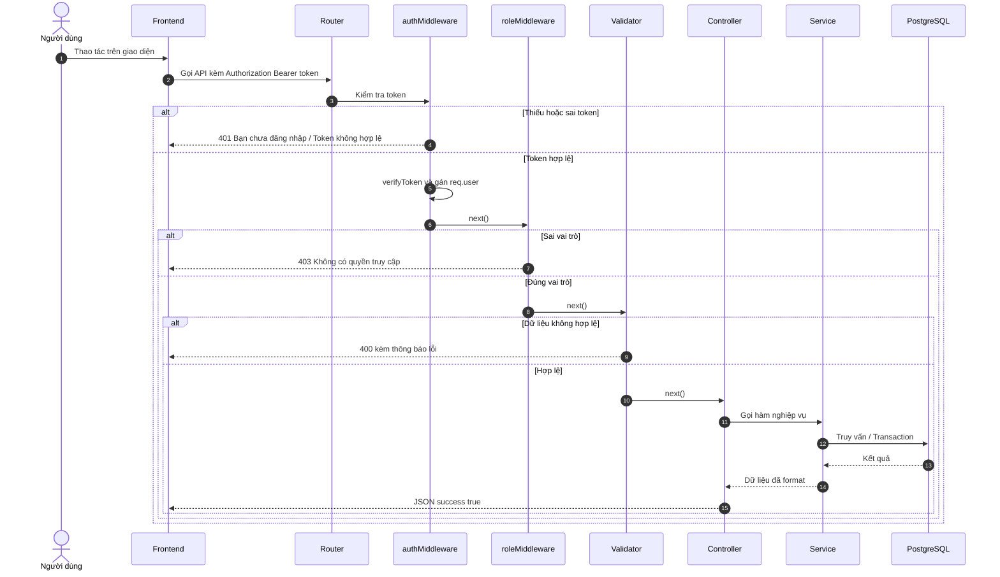

---

## 2. MA TRẬN RBAC 5 VAI TRÒ

### 2.1. Enum vai trò (Prisma `vai_tro_enum`)

| Vai trò | Ý nghĩa |
|---------|---------|
| `Admin` | Quản trị viên toàn hệ thống |
| `BacSi` | Bác sĩ khám bệnh |
| `YTa` | Y tá / kỹ thuật viên |
| `LeTan` | Lễ tân / thu ngân |
| `BenhNhan` | Bệnh nhân |

### 2.2. Quyền theo phân hệ được yêu cầu

| Nhóm API | Admin | BacSi | YTa | LeTan | BenhNhan |
|----------|:-----:|:-----:|:---:|:-----:|:--------:|
| `POST /auth/register`, `/login` | Public | Public | Public | Public | Public |
| `GET /auth/profile` | ✅ | ✅ | ✅ | ✅ | ✅ |
| `GET/PUT /patients/me*` | — | — | — | — | ✅ |
| `GET /patients` (danh sách) | ✅ | ✅ | — | ✅ | — |
| `GET/PUT /patients/:id/medical-record` | ✅ | ✅ | — | — | — |
| `DELETE /patients/:id` | ✅ | — | — | — | — |
| `POST /appointments` | ✅ | — | — | ✅ | ✅ |
| `GET /appointments/my-appointments` | — | — | — | — | ✅ |
| `GET /appointments` | ✅ | ✅ | — | ✅ | — |
| `GET /appointments/:id` | ✅ | ✅ | ✅⚠️ | ✅ | ✅ (chỉ của mình) |
| `PUT /appointments/:id/status` | ✅ | ✅⚠️ | ✅⚠️ | ✅⚠️ | ✅ (chỉ hủy) |
| `PUT /appointments/:id/reschedule` | ✅ | ✅⚠️ | ✅⚠️ | ✅⚠️ | ✅ (chỉ của mình) |
| `DELETE /appointments/:id` | ✅ | ✅⚠️ | ✅⚠️ | ✅⚠️ | ✅ (chỉ của mình) |
| `POST /invoices` | ✅ | — | — | ✅ | — |
| `GET /invoices` | ✅ | — | — | ✅ | — |
| `GET /invoices/:id` | ✅ | ✅⚠️ | ✅⚠️ | ✅⚠️ | ✅ (chỉ của mình) |
| `GET /invoices/my-invoices` | — | — | — | — | ✅ |
| `PUT /invoices/:id/pay` | ✅ | — | — | ✅ | — |
| `PUT /invoices/:id/cancel` | ✅ | — | — | ✅ (chỉ chưa TT) | — |
| `GET /statistics/*` | ✅ | — | — | — | — |

> ⚠️ = **không có `roleMiddleware`**, chỉ có `authMiddleware`. Bất kỳ vai trò nào đã đăng nhập đều gọi được; service chỉ chặn `BenhNhan` theo quyền sở hữu, nên `YTa` có thể thao tác trên lịch hẹn/hóa đơn của người khác.

### 2.3. Các route thiếu `roleMiddleware` (cần sửa ngay)

| File | Dòng | Route | Rủi ro |
|------|------|-------|--------|
| `backend/src/routers/appointment.router.js` | 56–61 | `GET /api/appointments/:id` | YTa đọc chi tiết lịch hẹn bất kỳ |
| `backend/src/routers/appointment.router.js` | 64–70 | `PUT /api/appointments/:id/status` | YTa đổi trạng thái bất kỳ (kể cả `DaKham`, `DaHuy`) |
| `backend/src/routers/appointment.router.js` | 73–79 | `PUT /api/appointments/:id/reschedule` | YTa dời lịch bất kỳ |
| `backend/src/routers/appointment.router.js` | 82–87 | `DELETE /api/appointments/:id` | YTa hủy lịch bất kỳ |
| `backend/src/routers/invoice.router.js` | 57–62 | `GET /api/invoices/:id` | YTa đọc hóa đơn bất kỳ |

**Gợi ý sửa:**
- `GET /:id` → `roleMiddleware("Admin", "LeTan", "BacSi", "BenhNhan")` + service check ownership (đã có).
- `status`, `reschedule`, `cancel` → `roleMiddleware("Admin", "LeTan", "BacSi", "BenhNhan")` + service kiểm tra transition.
- Hóa đơn `GET /:id` → `roleMiddleware("Admin", "LeTan", "BenhNhan")`.

---

## 3. PHÂN HỆ 1 — XÁC THỰC (AUTH)

### 3.1. Danh sách endpoint thực tế

| # | Method | Endpoint | Quyền | Validator | Controller | HTTP |
|---|--------|----------|-------|-----------|------------|------|
| 1 | POST | `/api/auth/register` | Public | `validateRegister` | `registerController` | 201 |
| 2 | POST | `/api/auth/login` | Public | `validateLogin` | `loginController` | **201** (nên là 200) |
| 3 | GET | `/api/auth/profile` | Mọi role có token | inline handler | — | 200 |
| 4 | GET | `/api/auth/admin-only` | `Admin` | — | — | 200 |
| 5 | GET | `/api/auth/patient-only` | `BenhNhan`, `BacSi` | — | — | 200 |

> Route 3–5 là **endpoint demo/test** cho middleware, không phục vụ nghiệp vụ thật. Route `/profile` trả về đúng payload trong token (`matk`, `vaitro`), **không phải hồ sơ đầy đủ**.

### 3.2. File liên quan

| File | Vai trò |
|------|---------|
| `backend/src/routers/auth.router.js` | Khai báo route |
| `backend/src/controllers/auth.controller.js` | Nhận request, gọi service |
| `backend/src/services/auth.service.js` | Đăng ký, đăng nhập, cấp JWT |
| `backend/src/validators/auth.validator.js` | Kiểm tra username/password/họ tên/giới tính/ngày sinh/SĐT |
| `backend/src/utils/password.js` | `bcrypt.hash(password, 12)` và `bcrypt.compare` |
| `backend/src/utils/jwt.js` | `jwt.sign` / `jwt.verify` với `JWT_SECRET` |
| `backend/src/middlewares/auth.middleware.js` | Middleware verify token dùng chung |
| `backend/.env.example` | Có khai báo `JWT_REFRESH_*` nhưng **code chưa dùng** |

### 3.3. Sequence — Đăng ký tài khoản

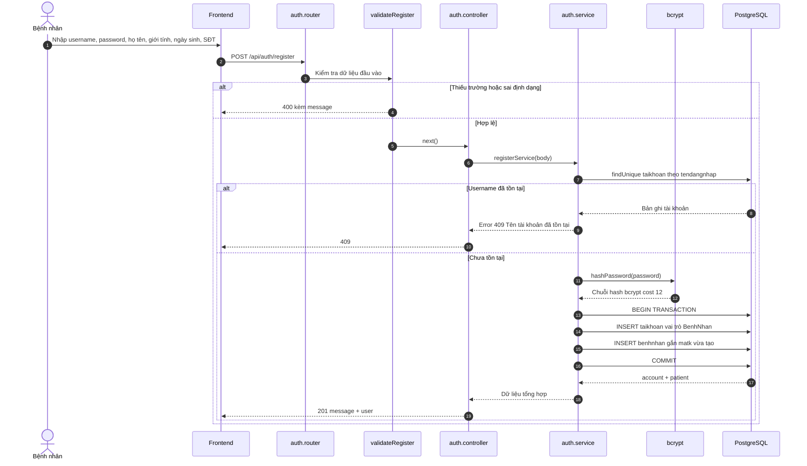

**Điểm quan trọng trong code**
- `registerService` **luôn gán `vaitro: "BenhNhan"`** — không có cách đăng ký công khai cho nhân viên (đúng nghiệp vụ).
- Tạo `taikhoan` + `benhnhan` trong **một transaction** ⇒ tránh tài khoản mồ côi.
- **Không tạo `hosobenhan`** lúc đăng ký; hồ sơ bệnh án được tự tạo khi bệnh nhân mở EMR lần đầu (xem mục 5).
- Validator chặn `gioitinh` chỉ `Nam`/`Nu`, trong khi schema cho phép `Khac` ⇒ không đồng bộ.
- Validator SĐT chỉ kiểm tra `length === 10`, không kiểm tra bắt đầu bằng `0` như validator cập nhật hồ sơ.

### 3.4. Sequence — Đăng nhập & cấp JWT

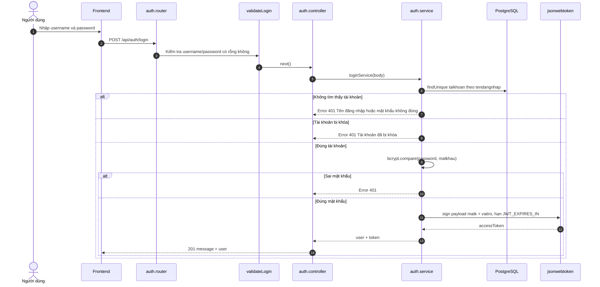

**Payload JWT thực tế:** `{ matk, vaitro, iat, exp }` — thiếu `tendangnhap`, `mabn`, `manv`.
**Hạn token:** `JWT_EXPIRES_IN` (mặc định `7d` nếu không cấu hình).

### 3.5. Nhận xét & lỗ hổng Auth

| ID | Mức | Vấn đề | Vị trí |
|----|-----|--------|--------|
| A1 | 🔴 | **Response đăng nhập bị lồng 2 lớp**: controller trả `{ message, user: { user: {...}, token } }` thay vì `{ success, accessToken, user }`. Frontend đọc `res.accessToken` sẽ `undefined`. | `auth.controller.js:14-24` + `auth.service.js:99-106` |
| A2 | 🔴 | **Không có refresh token** dù `.env.example` đã có `JWT_REFRESH_SECRET`. Token 7 ngày không thể thu hồi. | `utils/jwt.js`, `.env.example:19-20` |
| A3 | 🔴 | **Không có API đổi mật khẩu / quên mật khẩu / reset mật khẩu**. | Thiếu hoàn toàn |
| A4 | 🔴 | **Không có API logout/revoke token** (JWT stateless, không blacklist). | Thiếu hoàn toàn |
| A5 | 🟠 | **Không có API quản lý tài khoản nhân viên**: Admin không thể tạo tài khoản `LeTan`/`YTa`, không thể khóa/mở khóa, không thể đổi vai trò. | Thiếu hoàn toàn |
| A6 | 🟠 | **Khóa tài khoản không có hiệu lực tức thời**: `authMiddleware` chỉ verify chữ ký, không truy vấn lại `trangthai`. Tài khoản bị khóa vẫn dùng được token tới khi hết hạn (tối đa 7 ngày). | `auth.middleware.js:22-23` |
| A7 | 🟠 | Đăng nhập trả **HTTP 201** thay vì 200. | `auth.controller.js:17` |
| A8 | 🟡 | `GET /auth/profile` chỉ trả `matk`, `vaitro`; nhân viên không lấy được `manv`/`mabs`, bệnh nhân không lấy được `mabn` ⇒ phải gọi thêm API khác. | `auth.router.js:16-22` |
| A9 | 🟡 | Không giới hạn số lần đăng nhập sai (rate limit / captcha) ⇒ dễ brute-force. | `auth.router.js` |
| A10 | 🟡 | Không có validation độ mạnh mật khẩu (chỉ yêu cầu ≥ 6 ký tự). | `auth.validator.js:27` |

---

## 4. PHÂN HỆ 2 — MIDDLEWARE `verifyToken` & RBAC

### 4.1. Cơ chế hoạt động

**`auth.middleware.js`**
1. Đọc header `Authorization`.
2. Không có → `401 "Bạn chưa đăng nhập"`.
3. Tách `[type, token]`; yêu cầu `type === "Bearer"` và có token, nếu không → `401 "Định dạng token không hợp lệ"`.
4. `verifyToken(token)` bằng `JWT_SECRET`.
5. Gán `req.user = decoded`; lỗi → `401 "Token không hợp lệ hoặc đã hết hạn"`.

**`role.middleware.js`**
1. Không có `req.user` → `401`.
2. So sánh `req.user.vaitro` với danh sách `allowedRoles`.
3. Sai → `403` kèm danh sách vai trò được phép.

### 4.2. Sequence — Kiểm tra token và phân quyền

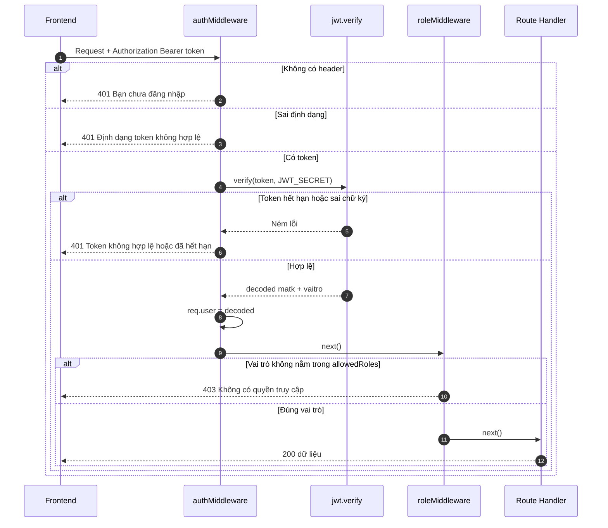

### 4.3. Nhận xét

- ✅ Đúng chuẩn tách biệt: xác thực (auth) và phân quyền (role) độc lập.
- ✅ Dùng chung cho 12/13 router; `statistics` áp dụng bằng `router.use(...)`.
- ❌ **5 route thiếu role** như bảng 2.3.
- ❌ Không kiểm tra lại trạng thái tài khoản trong DB (xem A6).
- ❌ Role là **chuỗi hard-code** ở nhiều nơi (`"Admin"`, `"LeTan"`…), dễ sai chính tả; nên tách `constants/role.constant.js`.
- ❌ Không có middleware ownership dùng chung; mỗi service tự query lại bệnh nhân theo `matk` (lặp code ở appointment, invoice, examination, prescription).

---

## 5. PHÂN HỆ 3 — HỒ SƠ CÁ NHÂN & TIỀN SỬ BỆNH ÁN

### 5.1. Danh sách endpoint thực tế (12)

| # | Method | Endpoint | Quyền | Validator | Ghi chú |
|---|--------|----------|-------|-----------|---------|
| 1 | GET | `/api/patients/me` | `BenhNhan` | — | Hồ sơ cá nhân + tài khoản |
| 2 | PUT | `/api/patients/me` | `BenhNhan` | `validateUpdateProfile` | Cập nhật họ tên, giới tính, ngày sinh, SĐT, địa chỉ, CCCD, BHYT |
| 3 | GET | `/api/patients/me/medical-record` | `BenhNhan` | — | **Tự tạo hồ sơ mặc định nếu chưa có** |
| 4 | PUT | `/api/patients/me/medical-record` | `BenhNhan` | `validateUpdateMedicalRecord` | `upsert` theo `mahsba = mabn` |
| 5 | DELETE | `/api/patients/me/medical-record` | `BenhNhan` | — | Reset nhóm máu về `ChuaRo`, xóa tiền sử/dị ứng/ghi chú |
| 6 | GET | `/api/patients/me/medical-history` | `BenhNhan` | — | Kèm bác sĩ, đơn thuốc, dịch vụ, hóa đơn |
| 7 | GET | `/api/patients/me/medical-history/:id` | `BenhNhan` | `validateIdParam` | Chỉ xem lần khám của chính mình |
| 8 | DELETE | `/api/patients/me` | `BenhNhan` | — | Safe Delete Guard |
| 9 | GET | `/api/patients` | `Admin`, `LeTan`, `BacSi` | `validatePatientQuery` | Tìm kiếm + phân trang |
| 10 | GET | `/api/patients/:id/medical-record` | `BacSi`, `Admin` | `validateIdParam` | Tra cứu EMR theo `mabn` |
| 11 | PUT | `/api/patients/:id/medical-record` | `BacSi`, `Admin` | `validateIdParam` + `validateUpdateMedicalRecord` | Bác sĩ cập nhật khi khám |
| 12 | DELETE | `/api/patients/:id` | `Admin` | `validateIdParam` | Safe Delete Guard |

### 5.2. Sequence — Bệnh nhân xem hồ sơ bệnh án (tự khởi tạo)

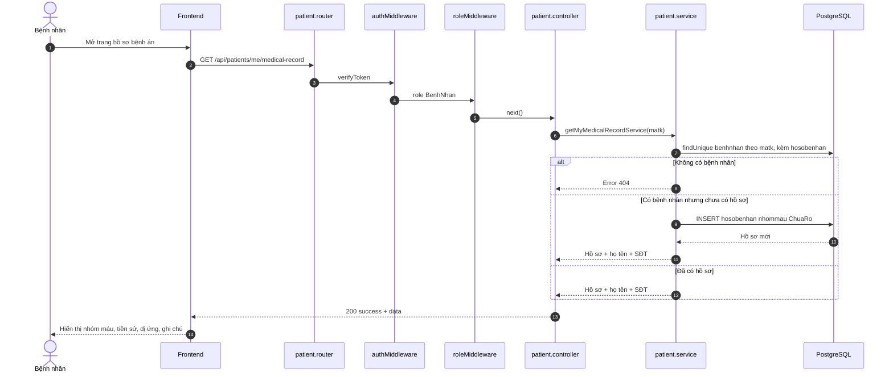

### 5.3. Sequence — Bác sĩ tra cứu / cập nhật EMR

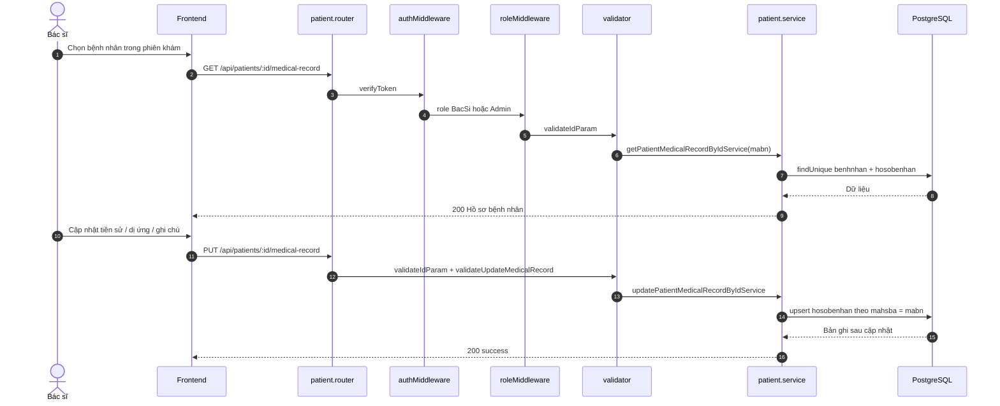

### 5.4. Nhận xét

**Điểm tốt**
- Tách rõ API cho bệnh nhân tự phục vụ (`/me/...`) và API cho nhân viên y tế (`/:id/...`).
- `getMyMedicalRecordService` **tự tạo hồ sơ mặc định** thay vì trả 404 ⇒ UI không bị vỡ.
- Kiểm tra quyền sở hữu ở `getMyMedicalHistoryDetailService` và `deleteMyAccountService`.
- Safe Delete Guard chặn xóa cứng khi đã có lịch sử khám/hóa đơn (đúng yêu cầu bảo toàn hồ sơ y tế).
- Validator khá chặt: CCCD 12 số, SĐT 10 số bắt đầu bằng 0, nhóm máu enum, giới hạn độ dài text.

**Thiếu / cần cải thiện**

| ID | Mức | Vấn đề |
|----|-----|--------|
| P1 | 🔴 | **Không có API tạo hồ sơ bệnh nhân tại quầy** (`POST /api/patients`). Lễ tân chỉ có thể đặt lịch cho bệnh nhân đã có `mabn`; bệnh nhân walk-in chưa có tài khoản thì không có cách tạo. |
| P2 | 🟠 | **Không có API khóa/mở khóa tài khoản bệnh nhân**. Thông báo lỗi khi xóa hồ sơ hướng dẫn "chuyển trạng thái sang KhoaTaiKhoan" nhưng không có endpoint nào làm việc đó. |
| P3 | 🟠 | `getMyMedicalHistory` và `getMyInvoices` **không phân trang**, bệnh nhân lâu năm có thể tải hàng trăm bản ghi. |
| P4 | 🟡 | Lịch sử khám trả cả `hoadon` lồng trong từng lần khám, trùng dữ liệu với `/invoices/my-invoices`; nên cân nhắc `select` gọn hơn. |
| P5 | 🟡 | Không có API xuất PDF/ảnh hồ sơ bệnh án. |
| P6 | 🟡 | `updateMyProfileService` dùng `where: { matk }` không ép `Number`, trong khi các service khác dùng `Number(matk)`; nếu payload token đổi kiểu sẽ lỗi. |
| P7 | 🟡 | Bệnh nhân có thể sửa `ngaysinh` thành ngày trong quá khứ xa (trước 1900 bị chặn) nhưng **không chặn ngày sinh trùng với người khác** — không phải yêu cầu bắt buộc. |

---

## 6. PHÂN HỆ 4 — ĐẶT LỊCH KHÁM TRỰC TUYẾN & CHỐNG TRÙNG KHUNG GIỜ

### 6.1. Danh sách endpoint thực tế (7)

| # | Method | Endpoint | Quyền | Validator | HTTP |
|---|--------|----------|-------|-----------|------|
| 1 | POST | `/api/appointments` | `BenhNhan`, `Admin`, `LeTan` | `validateCreateAppointment` | 201 |
| 2 | GET | `/api/appointments/my-appointments` | `BenhNhan` | — | 200 |
| 3 | GET | `/api/appointments` | `Admin`, `LeTan`, `BacSi` | `validateAppointmentQuery` | 200 |
| 4 | GET | `/api/appointments/:id` | Mọi role có token | `validateAppointmentId` | 200 |
| 5 | PUT | `/api/appointments/:id/status` | Mọi role có token | `validateAppointmentStatus` | 200 |
| 6 | PUT | `/api/appointments/:id/reschedule` | Mọi role có token | `validateRescheduleAppointment` | 200 |
| 7 | DELETE | `/api/appointments/:id` | Mọi role có token | `validateAppointmentId` | 200 |

### 6.2. Thuật toán khi tạo lịch (`createAppointmentService`)

1. **Xác định bệnh nhân**
   - `BenhNhan`: tìm `benhnhan` theo `matk` trong token; không có → 404.
   - `Admin`/`LeTan`: bắt buộc nhận `mabn` trong body; không có → 400; không tồn tại → 404.
2. **Kiểm tra bác sĩ** theo `mabs`; không tồn tại → 404.
3. **Kiểm tra ca trực** của bác sĩ trong ngày `ngayhen`:
   - Không có `phanconglamviec` nào → 400 "Bác sĩ không có lịch trực".
   - Giờ hẹn phải nằm trong `[giobatdau, gioketthuc)` của ít nhất 1 ca → nếu không 400.
4. **Chống trùng bác sĩ**: tìm `lichhen` cùng `mabs + ngayhen + giohen` với trạng thái `ChoXacNhan` hoặc `DaXacNhan` → 409.
5. **Chống trùng bệnh nhân**: tìm `lichhen` cùng `mabn + ngayhen + giohen` với 2 trạng thái trên → 409.
6. **Tạo lịch**:
   - `Admin`/`LeTan` → `DaXacNhan`.
   - `BenhNhan` → `ChoXacNhan`.

### 6.3. Sequence — Bệnh nhân đặt lịch trực tuyến

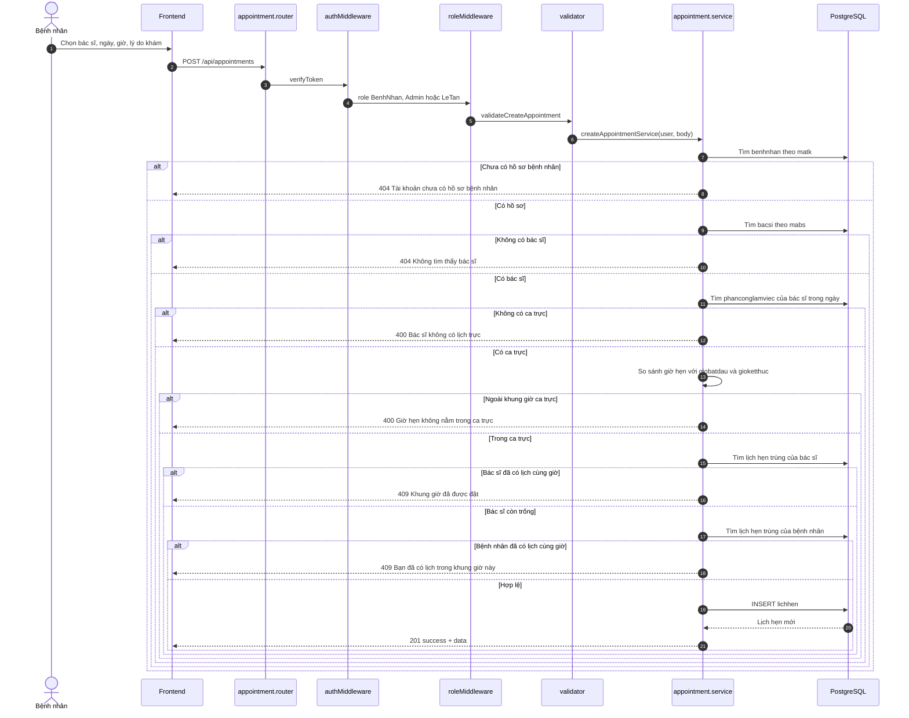

### 6.4. Sequence — Lễ tân duyệt / tiếp đón / hủy lịch

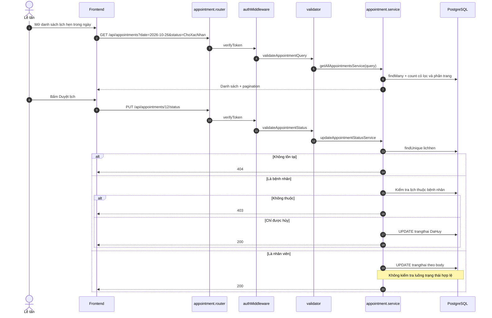

### 6.5. Sequence — Dời lịch

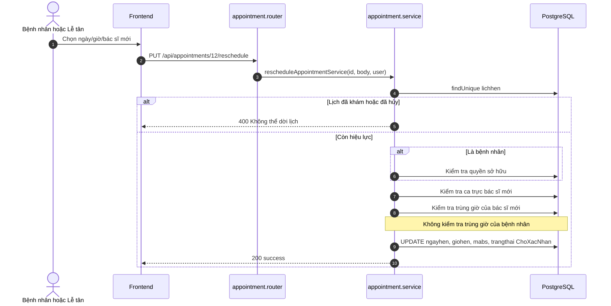

### 6.6. Máy trạng thái lịch hẹn

```
ChoXacNhan ──► DaXacNhan ──► DaKham
     │              │
     └──────────────┴──► DaHuy
```

- Enum thực tế chỉ có **4 trạng thái**: `ChoXacNhan`, `DaXacNhan`, `DaKham`, `DaHuy`.
- **Không có `DaTiepDon`** (tiếp đón) như tài liệu `API_FRONTEND_GUIDE.md` mô tả.
- Code **không chặn chuyển trạng thái sai**, ví dụ:
  - `DaKham` → `ChoXacNhan` vẫn được.
  - `DaHuy` → `DaXacNhan` vẫn được (hồi sinh lịch đã hủy).
  - Nhảy cóc `ChoXacNhan` → `DaKham`.
- Khi bác sĩ tạo phiếu khám có `malh`, `examination.service` tự cập nhật lịch hẹn thành `DaKham`.

### 6.7. Nhận xét & lỗ hổng Appointment

| ID | Mức | Vấn đề | Vị trí |
|----|-----|--------|--------|
| AP1 | 🔴 | **Chống trùng chỉ so sánh đúng phút tuyệt đối**, không theo slot 30 phút như comment mô tả. Đặt `08:00` và `08:15` cho cùng bác sĩ đều thành công. | `appointment.service.js:165-204` |
| AP2 | 🔴 | **Race condition**: kiểm tra trùng rồi mới `create`, không transaction + không unique constraint ⇒ 2 request đồng thời có thể cùng lọt. | `appointment.service.js:167-227` |
| AP3 | 🔴 | **Thiếu `roleMiddleware`** ở 4 route (xem 2.3) ⇒ YTa thao tác được mọi lịch. | `appointment.router.js:56-87` |
| AP4 | 🟠 | **Dời lịch không kiểm tra trùng giờ của bệnh nhân**, chỉ kiểm tra bác sĩ ⇒ bệnh nhân có thể có 2 lịch cùng giờ với 2 bác sĩ. | `appointment.service.js:532-547` |
| AP5 | 🟠 | **Không lưu lý do hủy**: route `DELETE /:id` không đọc body; schema `lichhen` không có cột `lydohuy`; `status` có `ghichu` nhưng ghi vào `lydokham`. | `appointment.service.js:400-456` |
| AP6 | 🟠 | **Không kiểm tra transition hợp lệ**; nhân viên có thể đặt `DaKham` trực tiếp hoặc hồi sinh `DaHuy`. | `appointment.service.js:414-453` |
| AP7 | 🟠 | `PUT /:id/status` không giới hạn role: bác sĩ/lễ tân/y tá đều đổi được; bệnh nhân chỉ được `DaHuy` nhưng **không kiểm tra trạng thái hiện tại** trước khi hủy (hủy lại lịch đã hủy vẫn 200). | `appointment.service.js:415-435` |
| AP8 | 🟠 | **Không có API khung giờ còn trống** ⇒ frontend phải tự đoán, dễ gửi giờ đã bị đặt và nhận 409. | Thiếu |
| AP9 | 🟡 | `validateCreateAppointment` chặn ngày quá khứ theo `toISOString()` (UTC). Trước 07:00 giờ Việt Nam, "hôm nay" theo UTC vẫn là hôm qua ⇒ có thể chặn nhầm hoặc cho qua sai. | `appointment.validator.js:59-65` |
| AP10 | 🟡 | `createAppointmentService` dùng `new Date(ngayhen.trim())` (UTC) cho cột `@db.Date`; cùng vấn đề múi giờ. | `appointment.service.js:122` |
| AP11 | 🟡 | `getMyAppointmentsService` không phân trang; bộ lọc chỉ có `status`. | `appointment.service.js:235-272` |
| AP12 | 🟡 | `getAllAppointmentsController` trả `data` và `pagination` ở top-level, không nằm trong `data` ⇒ khác chuẩn các API khác. | `appointment.controller.js:44-55` |
| AP13 | 🟡 | `GET /api/appointments` không cho `YTa` dù YTa cần biết lịch để hỗ trợ khám. | `appointment.router.js:47-53` |
| AP14 | 🟡 | Query dùng tên `date`, `doctorId`, `patientId`, `status` nhưng tài liệu hướng dẫn frontend lại ghi `ngay`, `mabs`, `mabn`, `trangthai` ⇒ frontend làm theo docs sẽ lọc sai. | `appointment.service.js:278` |

---

## 7. PHÂN HỆ 5 — HÓA ĐƠN VIỆN PHÍ & TRIGGER TÍNH TIỀN

### 7.1. Danh sách endpoint thực tế (8)

| # | Method | Endpoint | Quyền | Validator | HTTP |
|---|--------|----------|-------|-----------|------|
| 1 | POST | `/api/invoices` | `Admin`, `LeTan` | `validateCreateInvoice` | 201 |
| 2 | GET | `/api/invoices/my-invoices` | `BenhNhan` | — | 200 |
| 3 | GET | `/api/invoices` | `Admin`, `LeTan` | `validateInvoiceQuery` | 200 |
| 4 | GET | `/api/invoices/:id` | Mọi role có token | `validateInvoiceId` | 200 |
| 5 | POST | `/api/invoices/:id/items` | `Admin`, `LeTan` | `validateInvoiceId` + `validateAddInvoiceItem` | 200 |
| 6 | DELETE | `/api/invoices/:id/items/:itemId` | `Admin`, `LeTan` | `validateInvoiceId` | 200 |
| 7 | PUT | `/api/invoices/:id/pay` | `Admin`, `LeTan` | `validateInvoiceId` + `validateInvoicePayment` | 200 |
| 8 | PUT | `/api/invoices/:id/cancel` | `Admin`, `LeTan` | `validateInvoiceId` | 200 |

### 7.2. Sequence — Khởi tạo hóa đơn từ lần khám + trigger

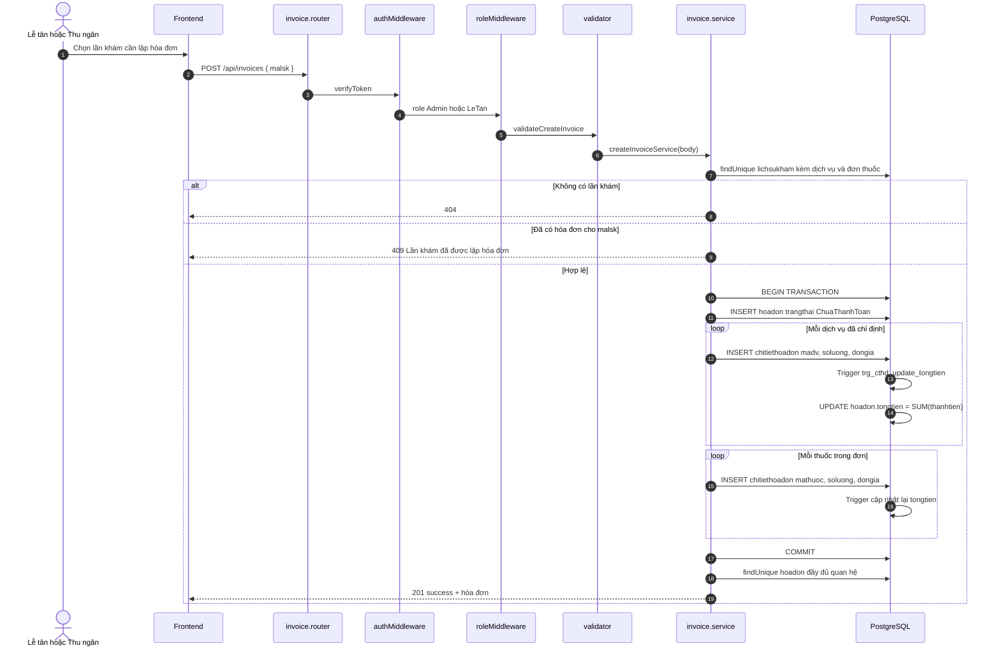

**Cơ chế trigger** (`quanlyphongkham_postgresql.sql:377-403`)

```sql
CREATE OR REPLACE FUNCTION fn_update_tongtien_hoadon()
RETURNS TRIGGER AS $$
DECLARE v_MaHD INT;
BEGIN
    IF (TG_OP = 'DELETE') THEN v_MaHD := OLD.MaHD;
    ELSE v_MaHD := NEW.MaHD;
    END IF;

    UPDATE HoaDon
    SET TongTien = (
        SELECT COALESCE(SUM(ThanhTien), 0)
        FROM ChiTietHoaDon
        WHERE MaHD = v_MaHD
    )
    WHERE MaHD = v_MaHD;

    RETURN NULL;
END;
$$ LANGUAGE plpgsql;

CREATE TRIGGER trg_cthd_update_tongtien
AFTER INSERT OR UPDATE OR DELETE ON ChiTietHoaDon
FOR EACH ROW
EXECUTE FUNCTION fn_update_tongtien_hoadon();
```

- `thanhtien` là **cột generated** `soluong * dongia` (Prisma: `@default(dbgenerated(...))`).
- Mỗi lần thêm/sửa/xóa dòng chi tiết, trigger tính lại **toàn bộ** `tongtien` của hóa đơn.
- Service **không tự cộng tiền** — đúng với invariant trong `AGENT_CONTEXT.md`.

### 7.3. Sequence — Thêm / xóa mục viện phí

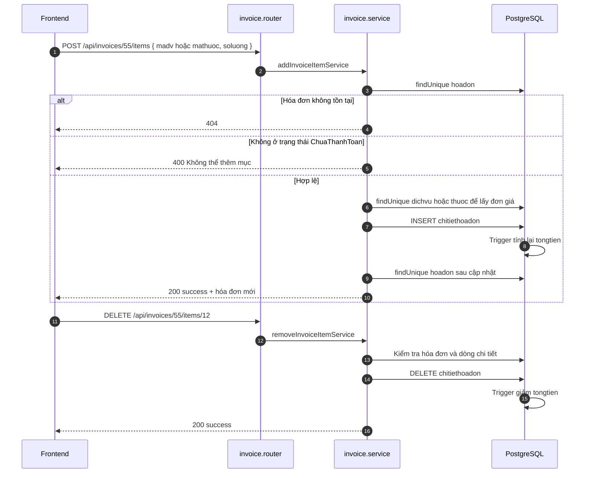

### 7.4. Sequence — Thanh toán / hủy hóa đơn

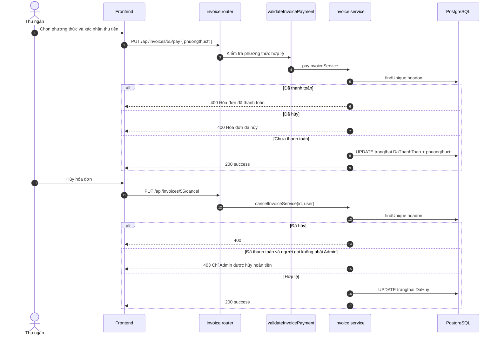

### 7.5. Nhận xét & lỗ hổng Invoice

| ID | Mức | Vấn đề | Vị trí |
|----|-----|--------|--------|
| IV1 | 🔴 | **Trigger không nằm trong migration Prisma**. Không có `prisma/migrations`, `package.json` không có script migrate. Nếu deploy bằng `prisma db push`, trigger không được tạo ⇒ `tongtien` luôn `0`. | `quanlyphongkham_postgresql.sql` + `backend/package.json` |
| IV2 | 🔴 | **Không có API lấy hóa đơn theo lần khám** (`GET /api/invoices/by-exam/:malsk`) ⇒ lễ tân phải tải cả danh sách để kiểm tra. | Thiếu |
| IV3 | 🔴 | **Không có API hoàn tiền** (refund toàn phần/một phần). `cancel` chỉ đổi trạng thái, không ghi nhận số tiền hoàn/người hoàn/thời điểm hoàn. | `invoice.service.js:400-452` |
| IV4 | 🟠 | **Cho phép client tự truyền `dongia`** khi thêm mục (`addInvoiceItemService`), có thể sửa giá dịch vụ/thuốc ⇒ thất thoát doanh thu. Nên chỉ cho Admin override và ghi audit. | `invoice.service.js:209-231` |
| IV5 | 🟠 | **Không kiểm tra lần khám đã kết thúc** trước khi lập hóa đơn; có thể lập khi bác sĩ chưa khám xong, sau đó phát sinh dịch vụ mới phải thêm tay. | `invoice.service.js:81-157` |
| IV6 | 🟠 | Gán `phuongthuctt` ngay khi **tạo** hóa đơn (chưa thu tiền) ⇒ dữ liệu phương thức thanh toán không phản ánh thời điểm trả. | `invoice.service.js:118-125` |
| IV7 | 🟡 | **Không có API cập nhật hóa đơn** (ghi chú, phương thức, giảm giá, bảo hiểm). | Thiếu |
| IV8 | 🟡 | **Không có API in/xuất PDF hóa đơn**. | Thiếu |
| IV9 | 🟡 | Trigger Postgres và trigger MySQL trong 2 file SQL **khác tên** (`trg_cthd_update_tongtien` vs `trg_cthd_after_insert/update/delete`) ⇒ tài liệu/agent dễ nhầm. | 2 file SQL |
| IV10 | 🟡 | `GET /api/invoices/:id` thiếu `roleMiddleware` (YTa đọc được). | `invoice.router.js:57-62` |
| IV11 | 🟡 | Query filter dùng `date/fromDate/toDate/status/paymentMethod/patientId`, tài liệu ghi `startDate/endDate/trangthaithanhtoan/mabn` ⇒ lệch hợp đồng API. | `invoice.service.js:458` |
| IV12 | 🟡 | Khi xóa dịch vụ khỏi lần khám (`examination`), hóa đơn chưa thanh toán **không được đồng bộ xóa** dòng tương ứng (chỉ có thêm). Cần kiểm tra chéo ở `examination.service`. | `invoice.service.js` / `examination.service.js` |

---

## 8. PHÂN HỆ 6 — THỐNG KÊ DOANH THU & BÁO CÁO LƯỢT KHÁM

### 8.1. Danh sách endpoint thực tế (5)

Toàn bộ router dùng `router.use(authMiddleware, roleMiddleware("Admin"))` ⇒ **chỉ Admin**.

| # | Method | Endpoint | Query | Dữ liệu trả về |
|---|--------|----------|-------|----------------|
| 1 | GET | `/api/statistics/overview` | — | Dashboard tổng quan |
| 2 | GET | `/api/statistics/revenue` | `startDate`, `endDate`, `groupBy` (`day`/`month`) | Doanh thu theo thời gian, phương thức, loại |
| 3 | GET | `/api/statistics/examinations` | `startDate`, `endDate` | Lượt khám theo chuyên khoa, bác sĩ, trạng thái lịch hẹn |
| 4 | GET | `/api/statistics/top-services` | `startDate`, `endDate`, `limit` | Top dịch vụ được chỉ định |
| 5 | GET | `/api/statistics/top-medicines` | `startDate`, `endDate`, `limit` | Top thuốc được kê |

### 8.2. Sequence — Admin xem báo cáo doanh thu

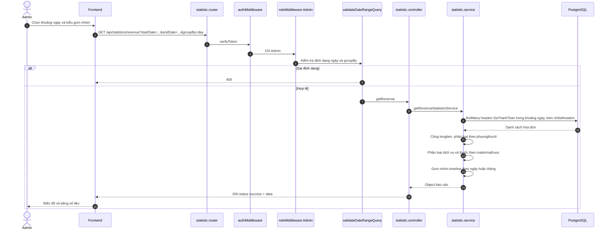

### 8.3. Công thức từng báo cáo

**Overview** (`statistic.service.js:10-77`)
- `tongbenhnhan` = `COUNT(benhnhan)`
- `tongbacsi` = `COUNT(bacsi)`
- `lichhen_homnay` = `COUNT(lichhen WHERE ngayhen = hôm nay)`
- `luotkham_homnay` = `COUNT(lichsukham WHERE ngay trong hôm nay)`
- `doanhthu_homnay`, `doanhthu_thangnay`, `tongdoanhthu` = `SUM(tongtien)` hóa đơn `DaThanhToan`
- `hoadon_chuathanhtoan` = `COUNT(hoadon ChuaThanhToan)`
- `lichhen_choxacnhan` = `COUNT(lichhen ChoXacNhan)`

**Revenue** (`statistic.service.js:82-182`)
- Mặc định 30 ngày gần nhất nếu không truyền ngày.
- `tong_doanhthu` = tổng `tongtien` hóa đơn đã thanh toán.
- `theo_phuongthuc`: `TienMat`, `ChuyenKhoan`, `TheThanhToan`, `ViDienTu`, `ChuaXacDinh`.
- `theo_loai`: `dichvu_kham` (dòng có `madv`), `thuoc` (dòng có `mathuoc`).
- `bieudo_doanhthu`: mảng `{ moc_thoigian, doanhthu, so_hoadon }` theo ngày/tháng.

**Examinations** (`statistic.service.js:187-273`)
- `tong_luotkham_thucte` = số `lichsukham` trong khoảng.
- `theo_chuyenkhoa`, `theo_bacsi` từ `lichsukham`.
- `tong_lichhen` + `trangthai_lichhen` từ `lichhen` trong khoảng.

**Top services / medicines** (`statistic.service.js:278-354`)
- `groupBy` trên `chitietdichvukham` / `chitietdonthuoc`, sắp xếp theo số lần hoặc tổng số lượng.

### 8.4. Nhận xét & lỗ hổng Statistics

| ID | Mức | Vấn đề | Vị trí |
|----|-----|--------|--------|
| ST1 | 🔴 | **`top-services` và `top-medicines` bỏ qua `startDate`/`endDate`**. Controller truyền vào nhưng service chỉ dùng `limit` ⇒ Admin lọc tháng 10 vẫn nhận top của toàn bộ thời gian. | `statistic.service.js:278-315`, `320-354` |
| ST2 | 🔴 | **Không có báo cáo bệnh nhân mới**, không có báo cáo riêng về lịch hẹn (tỷ lệ hủy/hoàn thành theo bác sĩ/khoa/nguồn đặt). | Thiếu |
| ST3 | 🟠 | **Không có xuất Excel/CSV/PDF** cho kế toán. | Thiếu |
| ST4 | 🟠 | **Không có doanh thu theo chuyên khoa / bác sĩ / dịch vụ** (chỉ có tổng theo loại). | Thiếu |
| ST5 | 🟠 | **`theo_loai` thiếu doanh thu "Khám bệnh"**: chỉ tách `madv` và `mathuoc`; nếu phí khám không gắn `madv` sẽ bị bỏ sót. | `statistic.service.js:176-179` |
| ST6 | 🟠 | **Không có chuỗi lượt khám theo ngày** (`theo_ngay`) như tài liệu mô tả; chỉ có tổng và nhóm theo khoa/bác sĩ. | `statistic.service.js:256-272` |
| ST7 | 🟡 | **Lệch múi giờ**: dùng `toISOString()` để lấy "hôm nay" (UTC). Trước 07:00 giờ VN, báo cáo "hôm nay" sẽ tính nhầm sang ngày hôm qua. | `statistic.service.js:11-14` |
| ST8 | 🟡 | Doanh thu gán theo **ngày lập hóa đơn** (`ngaylap`), không phải ngày thanh toán thực tế; hóa đơn lập hôm trước trả hôm sau vẫn tính vào ngày lập. | `statistic.service.js:100-104` |
| ST9 | 🟡 | `overview.lichhen_homnay` dùng `ngayhen: new Date(todayStr)` — nếu cột lưu timestamp sẽ không khớp; hiện là `@db.Date` nên tạm ổn. | `statistic.service.js:34-36` |
| ST10 | 🟡 | Response dùng `status: "success"` thay vì `success: true` ⇒ frontend phải xử lý 2 kiểu. | `statistic.controller.js:15` |
| ST11 | 🟡 | Không có cache; mỗi lần mở dashboard chạy nhiều `aggregate` song song trên bảng lớn. | `statistic.service.js:21-64` |

---

## 9. DANH MỤC ENDPOINT CÁC MODULE HỖ TRỢ (52 endpoint)

> Các module này không nằm trong 7 chức năng được yêu cầu nhưng **trực tiếp tham gia luồng** đặt lịch → khám → kê đơn → tính tiền.

### 9.1. Chuyên khoa — `/api/specialties` (5)

| Method | Endpoint | Quyền |
|--------|----------|-------|
| GET | `/api/specialties` | Public |
| GET | `/api/specialties/:id` | Public |
| POST | `/api/specialties` | Admin |
| PUT | `/api/specialties/:id` | Admin |
| DELETE | `/api/specialties/:id` | Admin (Safe Delete) |

### 9.2. Bác sĩ — `/api/doctors` (6)

| Method | Endpoint | Quyền | Ghi chú |
|--------|----------|-------|---------|
| GET | `/api/doctors` | Public | Lọc `specialtyId`, `search`, phân trang |
| GET | `/api/doctors/:id` | Public | |
| GET | `/api/doctors/:id/schedule` | Public | **Trả ca trực, không trả slot trống** |
| POST | `/api/doctors` | Admin | Tạo `nhanvien` + `bacsi` + `taikhoan` |
| PUT | `/api/doctors/:id` | Admin | |
| DELETE | `/api/doctors/:id` | Admin | Safe Delete |

### 9.3. Phòng khám — `/api/rooms` (5)

| Method | Endpoint | Quyền |
|--------|----------|-------|
| GET | `/api/rooms` | Public |
| GET | `/api/rooms/:id` | Public |
| POST | `/api/rooms` | Admin |
| PUT | `/api/rooms/:id` | Admin |
| DELETE | `/api/rooms/:id` | Admin (Safe Delete) |

### 9.4. Dịch vụ — `/api/services` (5)

| Method | Endpoint | Quyền |
|--------|----------|-------|
| GET | `/api/services` | Public |
| GET | `/api/services/:id` | Public |
| POST | `/api/services` | Admin |
| PUT | `/api/services/:id` | Admin |
| DELETE | `/api/services/:id` | Admin (Safe Delete) |

### 9.5. Ca làm việc & phân công — `/api/shifts` (8)

| Method | Endpoint | Quyền | Ghi chú |
|--------|----------|-------|---------|
| GET | `/api/shifts` | Mọi role có token | Lọc ngày/phòng/nhân viên/chuyên khoa |
| GET | `/api/shifts/staff/:staffId` | Mọi role có token | Lịch trực cá nhân |
| GET | `/api/shifts/:id` | Mọi role có token | |
| POST | `/api/shifts` | Admin | Tạo ca + phân công, chặn trùng giờ |
| PUT | `/api/shifts/:id` | Admin | |
| DELETE | `/api/shifts/:id` | Admin | |
| POST | `/api/shifts/:id/assign` | Admin | Phân công nhân sự |
| DELETE | `/api/shifts/:id/assign/:staffId` | Admin | Hủy phân công |

### 9.6. Phiếu khám bệnh — `/api/examinations` (8)

| Method | Endpoint | Quyền | Ghi chú |
|--------|----------|-------|---------|
| POST | `/api/examinations` | Admin, BacSi | Tạo phiếu + chỉ định dịch vụ; tự đổi lịch hẹn sang `DaKham` nếu có `malh` |
| GET | `/api/examinations` | Admin, BacSi, LeTan | Lọc `mabn`, `mabs`, ngày, từ khóa |
| GET | `/api/examinations/:id` | Admin, BacSi, LeTan, BenhNhan | Bệnh nhân chỉ xem của mình |
| PUT | `/api/examinations/:id` | Admin, BacSi | Cập nhật triệu chứng/chẩn đoán/kết luận |
| POST | `/api/examinations/:id/services` | Admin, BacSi | Chỉ định bổ sung |
| PUT | `/api/examinations/:id/services/:detailId` | Admin, BacSi, YTa | Cập nhật kết quả cận lâm sàng |
| DELETE | `/api/examinations/:id/services/:detailId` | Admin, BacSi | Hủy chỉ định |
| DELETE | `/api/examinations/:id` | Admin, BacSi | Safe Delete |

### 9.7. Kho thuốc — `/api/medicines` (9)

| Method | Endpoint | Quyền |
|--------|----------|-------|
| GET | `/api/medicines` | Public |
| GET | `/api/medicines/alerts` | Admin, BacSi, YTa |
| GET | `/api/medicines/stats/overview` | Admin |
| GET | `/api/medicines/:id` | Public |
| POST | `/api/medicines` | Admin |
| PUT | `/api/medicines/:id` | Admin |
| POST | `/api/medicines/:id/import` | Admin |
| PUT | `/api/medicines/:id/stock` | Admin |
| DELETE | `/api/medicines/:id` | Admin (Safe Delete) |

### 9.8. Đơn thuốc — `/api/prescriptions` (6)

| Method | Endpoint | Quyền | Ghi chú |
|--------|----------|-------|---------|
| POST | `/api/prescriptions` | Admin, BacSi | Tự kiểm tra và trừ kho |
| GET | `/api/prescriptions` | Admin, BacSi, LeTan, YTa, BenhNhan | Bệnh nhân chỉ thấy đơn của mình |
| GET | `/api/prescriptions/exam/:examId` | Admin, BacSi, LeTan, YTa, BenhNhan | Đặt trước `/:id` để tránh xung đột |
| GET | `/api/prescriptions/:id` | Admin, BacSi, LeTan, YTa, BenhNhan | |
| PUT | `/api/prescriptions/:id` | Admin, BacSi | Chỉ khi hóa đơn chưa thanh toán |
| DELETE | `/api/prescriptions/:id` | Admin, BacSi | Hoàn kho |

---

> **Lưu ý lịch sử:** Mục 10 và 11 dưới đây là đề xuất tại thời điểm 26/10/2026. Nhiều endpoint trong danh sách đã được triển khai; xem bảng trạng thái hiện tại ở mục 0.1 phía trên.

## 10. DANH SÁCH ENDPOINT CÒN THIẾU (ĐỀ XUẤT BỔ SUNG — ẢNH CHỤP CŨ)

### 10.1. Ưu tiên P0 — thiếu sẽ chặn nghiệp vụ chính

| # | Method | Endpoint đề xuất | Quyền | Mục đích |
|---|--------|------------------|-------|----------|
| 1 | POST | `/api/patients` | Admin, LeTan | **Tạo hồ sơ bệnh nhân walk-in** (không cần tài khoản). Body: `hoten, gioitinh, ngaysinh, sdt, diachi, cccd, sobhyt`. Hiện chỉ có `register` tạo tài khoản + bệnh nhân, không phù hợp lễ tân. |
| 2 | GET | `/api/appointments/available-slots` | Public hoặc mọi role | **Trả khung giờ còn trống** theo `mabs` + `date` + `slotMinutes` (mặc định 30). Kết quả: các mốc `08:00`, `08:30`… sau khi trừ ca trực và lịch đã đặt. |
| 3 | PATCH | `/api/appointments/:id/check-in` | Admin, LeTan | **Tiếp đón bệnh nhân**: đổi `DaXacNhan → DaTiepDon`, ghi `thoigiantiepdon`, cấp `sohangcho`. Cần bổ sung enum `DaTiepDon` + cột tương ứng. |
| 4 | PUT | `/api/appointments/:id/cancel` | Admin, LeTan, BenhNhan | **Hủy kèm lý do bắt buộc**. Body `{ lydohuy }`; cần thêm cột `lydohuy` vào `lichhen`. (Hiện `DELETE /:id` bỏ qua body.) |
| 5 | POST | `/api/auth/refresh-token` | Public (có refresh token) | Cấp access token mới; dùng `JWT_REFRESH_SECRET` đã có trong `.env.example`. |
| 6 | POST | `/api/auth/logout` | Mọi role | Thu hồi refresh token / đưa access token vào blacklist ngắn hạn. |
| 7 | PUT | `/api/auth/change-password` | Mọi role | Body `{ matkhauCu, matkhauMoi }`; kiểm tra bcrypt, hash lại. |
| 8 | GET | `/api/invoices/by-exam/:malsk` | Admin, LeTan | Lễ tân kiểm tra nhanh lần khám đã có hóa đơn chưa, tránh mở nhầm. |
| 9 | POST | `/api/invoices/:id/refund` | Admin | **Hoàn tiền** toàn phần/một phần; ghi nhận số tiền, lý do, người thực hiện. |
| 10 | — | Bổ sung `roleMiddleware` cho 5 route | — | Không phải endpoint mới nhưng **bắt buộc sửa**: 4 route appointment + 1 route invoice (bảng 2.3). |

### 10.2. Ưu tiên P1 — hoàn thiện vận hành

| # | Method | Endpoint đề xuất | Quyền | Mục đích |
|---|--------|------------------|-------|----------|
| 11 | GET | `/api/auth/accounts` | Admin | Danh sách tài khoản, lọc theo vai trò/trạng thái. |
| 12 | POST | `/api/auth/accounts` | Admin | Tạo tài khoản nhân viên (`LeTan`, `YTa`, `BacSi`). |
| 13 | PATCH | `/api/auth/accounts/:id/status` | Admin | Khóa/mở khóa tài khoản (`HoatDong` ↔ `KhoaTaiKhoan`). |
| 14 | PATCH | `/api/auth/accounts/:id/role` | Admin | Đổi vai trò (có audit). |
| 15 | GET | `/api/auth/me` | Mọi role | Trả hồ sơ đầy đủ: `matk, vaitro, tendangnhap, mabn` hoặc `manv/mabs`. |
| 16 | POST | `/api/auth/forgot-password` | Public | Gửi OTP/link reset qua SMS/email. |
| 17 | POST | `/api/auth/reset-password` | Public | Đặt lại mật khẩu bằng OTP/token. |
| 18 | GET | `/api/appointments/queue` | Admin, LeTan, BacSi | **Hàng chờ trong ngày**: sắp theo giờ hẹn/giờ tiếp đón, trả số thứ tự và trạng thái. |
| 19 | GET | `/api/patients/:id/appointments` | Admin, LeTan, BacSi | Xem lịch hẹn của một bệnh nhân cụ thể (hiện chỉ bệnh nhân tự xem được của mình). |
| 20 | GET | `/api/patients/:id/invoices` | Admin, LeTan | Xem hóa đơn của một bệnh nhân cụ thể. |
| 21 | GET | `/api/statistics/patients` | Admin | Bệnh nhân mới theo ngày/tháng, phân bố giới tính/độ tuổi. |
| 22 | GET | `/api/statistics/appointments` | Admin | Tỷ lệ duyệt/hủy/hoàn thành, theo bác sĩ/khoa/khung giờ. |
| 23 | GET | `/api/statistics/revenue/by-specialty` | Admin | Doanh thu theo chuyên khoa. |
| 24 | GET | `/api/statistics/revenue/by-doctor` | Admin | Doanh thu theo bác sĩ. |
| 25 | GET | `/api/statistics/export` | Admin | Xuất Excel/CSV cho kế toán (`type=revenue|examinations|patients`). |

### 10.3. Ưu tiên P2 — nâng cao

| # | Method | Endpoint đề xuất | Quyền | Mục đích |
|---|--------|------------------|-------|----------|
| 26 | GET | `/api/invoices/:id/print` | Admin, LeTan, BenhNhan | PDF/HTML hóa đơn. |
| 27 | PUT | `/api/invoices/:id` | Admin, LeTan | Cập nhật ghi chú/giảm giá/bảo hiểm khi chưa thanh toán. |
| 28 | POST | `/api/invoices/:id/apply-insurance` | Admin, LeTan | Áp dụng BHYT, tính phần bệnh nhân trả. |
| 29 | GET | `/api/statistics/inventory` | Admin | Báo cáo kho thuốc (nhập/xuất/tồn/sắp hết hạn) — hiện chỉ có `/medicines/stats/overview`. |
| 30 | GET | `/api/audit-logs` | Admin | Nhật ký thao tác nhạy cảm (hủy hóa đơn, hoàn tiền, đổi giá, khóa tài khoản). |
| 31 | POST | `/api/appointments/:id/reminder` | Admin, LeTan | Gửi nhắc lịch qua SMS/email. |
| 32 | GET | `/api/notifications` | Mọi role | Thông báo trong ứng dụng (lịch hẹn, kết quả khám, hóa đơn). |
| 33 | POST | `/api/payments/webhook` | Public có chữ ký | Nhận callback VNPay/MoMo/ZaloPay nếu triển khai thanh toán online. |
| 34 | GET | `/api/patients/me/export` | BenhNhan | Xuất hồ sơ bệnh án PDF. |

### 10.4. Endpoint tài liệu nhắc nhưng **không tồn tại** trong code

| Tài liệu ghi | Thực tế | Ghi chú |
|--------------|---------|---------|
| `PATCH /api/appointments/:id/status` | `PUT /api/appointments/:id/status` | Sai method |
| `PATCH /api/appointments/:id/reschedule` | `PUT /api/appointments/:id/reschedule` | Sai method |
| `DELETE /api/appointments/:id/cancel` | `DELETE /api/appointments/:id` | Sai path |
| `PATCH /api/invoices/:id/pay` | `PUT /api/invoices/:id/pay` | Sai method |
| `PATCH /api/invoices/:id/cancel` | `PUT /api/invoices/:id/cancel` | Sai method |
| Trạng thái `DaTiepDon` | Không có trong enum | Cần bổ sung nếu muốn tiếp đón riêng |
| `phuongthucthanhtoan` | `phuongthuctt` | Sai tên field |
| `TheNganHang` | `TheThanhToan` | Sai giá trị enum |
| Query `ngay/mabs/mabn/trangthai` | `date/doctorId/patientId/status` | Sai tên query |
| Query `startDate/endDate` (invoices) | `date/fromDate/toDate` | Sai tên query |
| Body thêm item `noidung/loaichiphi` | `madv` hoặc `mathuoc` | Sai cấu trúc |
| `accessToken` top-level khi login | `user.token` (lồng trong `user`) | Sai cấu trúc response |

---

## 11. TỔNG HỢP LỖI & THỨ TỰ ƯU TIÊN SỬA

### 11.1. 10 việc cần làm ngay (theo thứ tự)

| Ưu tiên | Việc cần làm | File | Ảnh hưởng |
|:------:|--------------|------|-----------|
| 1 | Thêm `roleMiddleware` cho 5 route đang hở | `appointment.router.js`, `invoice.router.js` | Bảo mật |
| 2 | Sửa response đăng nhập về `{ success, message, accessToken, user }`; đổi 201 → 200 | `auth.controller.js`, `auth.service.js` | Frontend đăng nhập được |
| 3 | Đưa trigger `trg_cthd_update_tongtien` vào migration/script deploy bắt buộc | `prisma/`, `queries/` | Hóa đơn tính đúng tiền |
| 4 | Chống trùng lịch theo **slot 30 phút** + transaction/unique index | `appointment.service.js`, `schema.prisma` | Tránh 2 bệnh nhân cùng slot |
| 5 | Kiểm tra trùng lịch bệnh nhân khi reschedule | `appointment.service.js:532-547` | Tránh 1 bệnh nhân 2 lịch cùng giờ |
| 6 | Validate luồng trạng thái lịch hẹn (state machine) | `appointment.service.js:400-456` | Không hồi sinh lịch đã hủy |
| 7 | Lưu lý do hủy (`lydohuy`) + API hủy có body | `schema.prisma`, `appointment.service.js` | Truy vết nghiệp vụ |
| 8 | Áp dụng `startDate/endDate` cho top-services/top-medicines | `statistic.service.js:278-354` | Báo cáo đúng kỳ |
| 9 | Thêm API khung giờ trống + tạo bệnh nhân walk-in | module mới | Hoàn thiện luồng lễ tân |
| 10 | Thêm refresh token / đổi mật khẩu / khóa tài khoản | `auth.*` | Bảo mật tài khoản |

### 11.2. Bảng lỗi chi tiết (đã phát hiện)

| ID | Mức | Mô tả ngắn | File |
|----|-----|------------|------|
| A1 | 🔴 | Login response lồng 2 lớp, thiếu `success`/`accessToken` | `auth.controller.js:14-24` |
| A2–A5 | 🔴 | Thiếu refresh/logout/đổi mật khẩu/quản lý tài khoản | `auth.*` |
| A6 | 🟠 | Token của tài khoản bị khóa vẫn dùng được đến khi hết hạn | `auth.middleware.js:22-23` |
| A7 | 🟠 | Login trả 201 | `auth.controller.js:17` |
| RBAC1 | 🔴 | 5 route thiếu `roleMiddleware` | `appointment.router.js`, `invoice.router.js` |
| P1 | 🔴 | Không có API tạo bệnh nhân walk-in | Thiếu |
| AP1 | 🔴 | Chống trùng chỉ đúng phút tuyệt đối, không theo slot 30 phút | `appointment.service.js:165-204` |
| AP2 | 🔴 | Race condition khi đặt lịch | `appointment.service.js:167-227` |
| AP4 | 🟠 | Reschedule không check trùng giờ bệnh nhân | `appointment.service.js:532-547` |
| AP5 | 🟠 | Không lưu lý do hủy | `appointment.service.js:400-456` |
| AP6 | 🟠 | Không validate transition trạng thái | `appointment.service.js:414-453` |
| IV1 | 🔴 | Trigger không có trong migration Prisma | `quanlyphongkham_postgresql.sql` |
| IV2 | 🔴 | Thiếu API hóa đơn theo lần khám | Thiếu |
| IV3 | 🔴 | Thiếu API hoàn tiền | Thiếu |
| IV4 | 🟠 | Client được tự truyền `dongia` | `invoice.service.js:209-231` |
| IV5 | 🟠 | Có thể lập hóa đơn khi lần khám chưa kết thúc | `invoice.service.js:81-157` |
| ST1 | 🔴 | Top services/medicines bỏ qua khoảng ngày | `statistic.service.js:278-354` |
| ST2 | 🔴 | Thiếu báo cáo bệnh nhân & lịch hẹn | Thiếu |
| ST3–ST4 | 🟠 | Thiếu export, doanh thu theo khoa/bác sĩ | Thiếu |
| ST5 | 🟠 | `theo_loai` thiếu phí khám bệnh | `statistic.service.js:176-179` |
| ST6 | 🟠 | Thiếu chuỗi lượt khám theo ngày | `statistic.service.js:256-272` |
| ST7 | 🟡 | Lệch múi giờ khi tính "hôm nay" | `statistic.service.js:11-14` |

### 11.3. Kiểm thử nhanh bằng curl (PowerShell)

```powershell
# 1. Đăng ký
curl.exe -X POST http://localhost:5000/api/auth/register `
  -H "Content-Type: application/json" `
  -d '{"username":"benhnhan01","password":"123456","hoten":"Nguyen Van A","gioitinh":"Nam","ngaysinh":"2000-01-01","sdt":"0901234567"}'

# 2. Đăng nhập — lưu token
$res = curl.exe -s -X POST http://localhost:5000/api/auth/login `
  -H "Content-Type: application/json" `
  -d '{"username":"benhnhan01","password":"123456"}' | ConvertFrom-Json
$token = $res.user.token
Write-Host "Token:" $token

# 3. Xem hồ sơ
curl.exe -H "Authorization: Bearer $token" http://localhost:5000/api/patients/me

# 4. Đặt lịch
curl.exe -X POST http://localhost:5000/api/appointments `
  -H "Content-Type: application/json" `
  -H "Authorization: Bearer $token" `
  -d '{"mabs":1,"ngayhen":"2026-11-01","giohen":"08:00","lydokham":"Kham tong quat"}'

# 5. Kiểm tra RBAC: gọi route Admin bằng token bệnh nhân, phải nhận 403
curl.exe -H "Authorization: Bearer $token" http://localhost:5000/api/statistics/overview
```

### 11.4. Checklist nghiệm thu theo 7 chức năng

| Chức năng | Kịch bản kiểm thử tối thiểu | Kỳ vọng |
|-----------|-----------------------------|---------|
| Auth | Đăng ký trùng username; đăng nhập sai mật khẩu; token hết hạn | 409 / 401 / 401 |
| RBAC | Bệnh nhân gọi API Admin; YTa gọi API sửa lịch | 403 |
| Hồ sơ | Bệnh nhân mới mở EMR; sửa CCCD trùng; xóa tài khoản đã có lịch sử | Tự tạo hồ sơ / 409 / 400 |
| Đặt lịch | Đặt ngoài ca trực; trùng giờ bác sĩ; trùng giờ bệnh nhân; 2 request đồng thời | 400 / 409 / 409 / chỉ 1 thành công |
| Lễ tân | Duyệt → tiếp đón → khám → hủy; hủy không lý do; hồi sinh lịch đã hủy | Đúng luồng / 400 / 400 |
| Hóa đơn | Tạo hóa đơn 2 lần cùng `malsk`; thêm mục khi đã thanh toán; thanh toán lần 2; hủy hóa đơn đã thu tiền bởi Lễ tân | 409 / 400 / 400 / 403 |
| Thống kê | Doanh thu tháng có hóa đơn hủy; top dịch vụ lọc 1 ngày; xuất báo cáo | Không tính hóa đơn hủy / đúng ngày / có file |

---

## 12. KẾT LUẬN (ẢNH CHỤP 26/10)

- **6/7 phân hệ đã có API chạy được ở mức cơ bản**, đúng kiến trúc 3 lớp, validate khá chặt, có transaction ở các luồng quan trọng.
- **Điểm mạnh:** tách bạch router/controller/service, xử lý ca trực khi đặt lịch, trigger tính tiền tập trung ở DB, Safe Delete Guard bảo vệ hồ sơ y tế, tự tạo hồ sơ bệnh án khi thiếu.
- **Rủi ro lớn nhất cần xử lý trước khi demo/bảo vệ:**
  1. **Phân quyền hở** ở 5 route appointment/invoice.
  2. **Hợp đồng API đăng nhập sai** (response lồng, thiếu `accessToken`).
  3. **Trigger không được deploy kèm** ⇒ hóa đơn có thể luôn bằng 0.
  4. **Chống trùng khung giờ chưa đúng** (chỉ đúng phút, không theo slot, có race condition).
  5. **Báo cáo top bỏ qua bộ lọc ngày** ⇒ số liệu sai khi bảo vệ.
- **Tài liệu `API_FRONTEND_GUIDE.md` đã lỗi thời** so với code (method, path, tên field, enum, query). Nên cập nhật lại theo bảng 10.4 hoặc tạo OpenAPI/Swagger để tránh frontend tích hợp sai.

> **Khuyến nghị:** bổ sung `prisma/migrations` + script seed trigger; viết test tích hợp cho 5 luồng P0; chuẩn hóa response `{ success, message, data }`; đưa danh sách vai trò và trạng thái vào `constants/` dùng chung.

> **Kế hoạch khắc phục:** xem `KE_HOACH_KHAC_PHUC_THIEU_XOT.md` (6 sprint, 246 giờ, có checklist và lịch trình).


