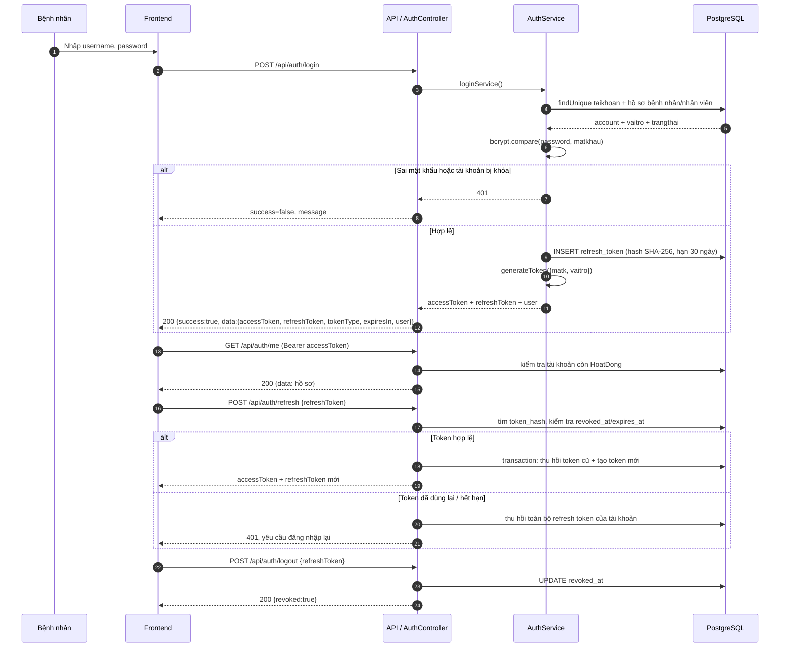
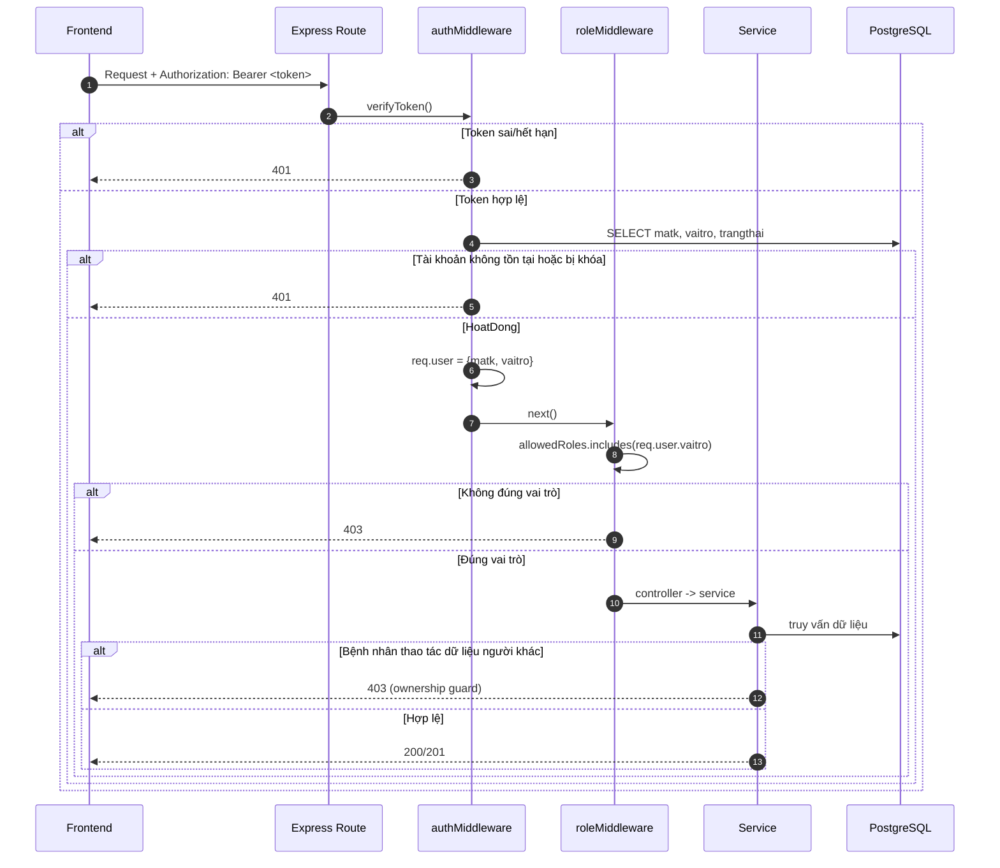
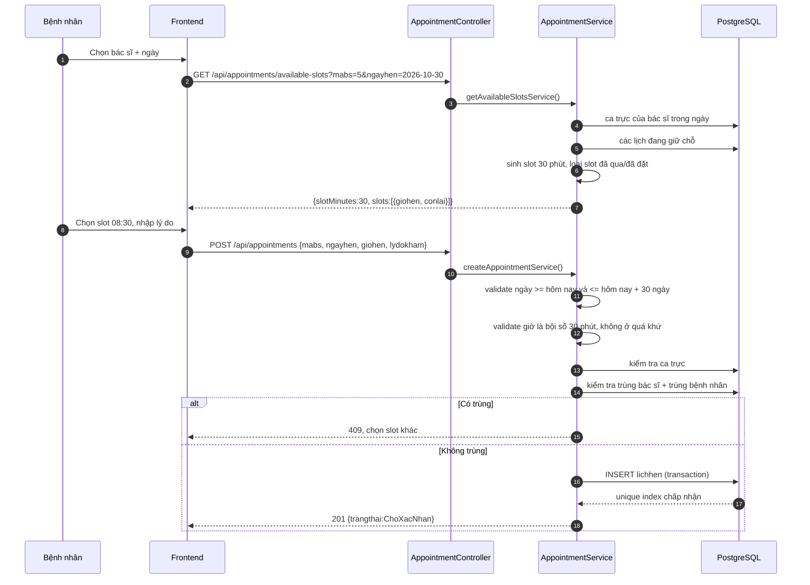
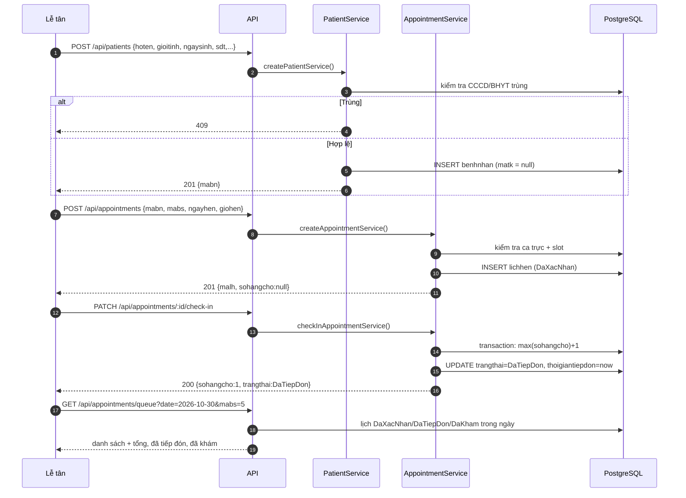
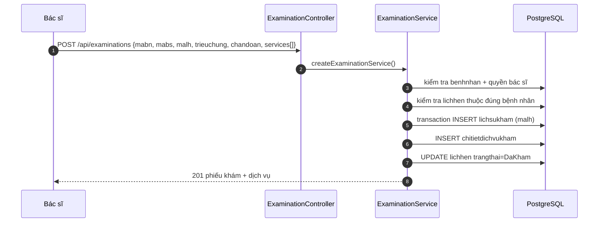
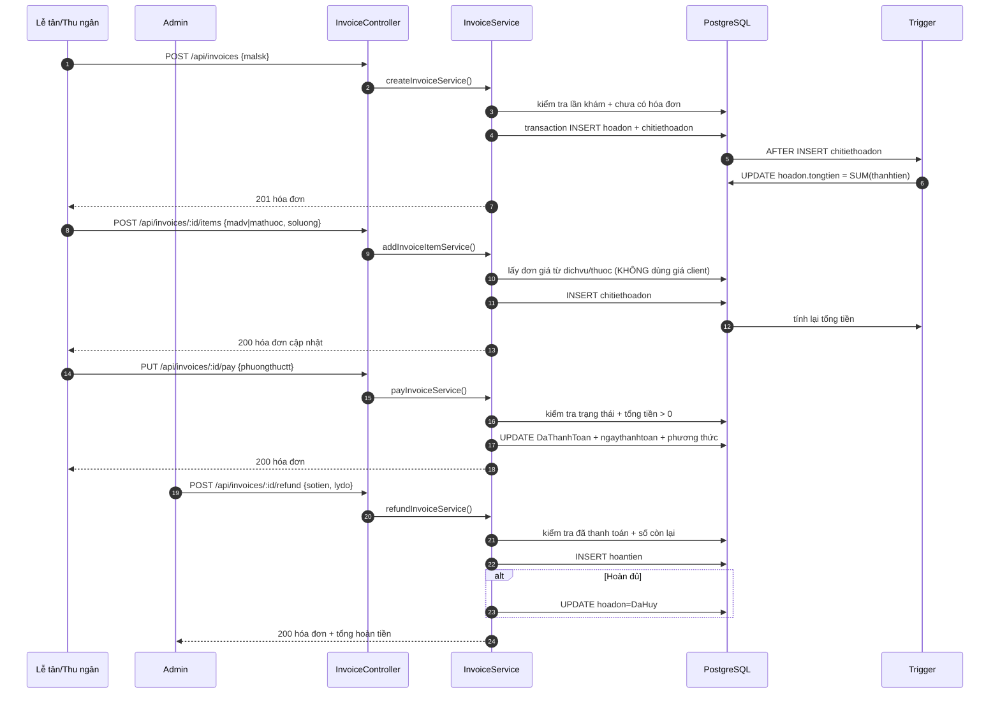
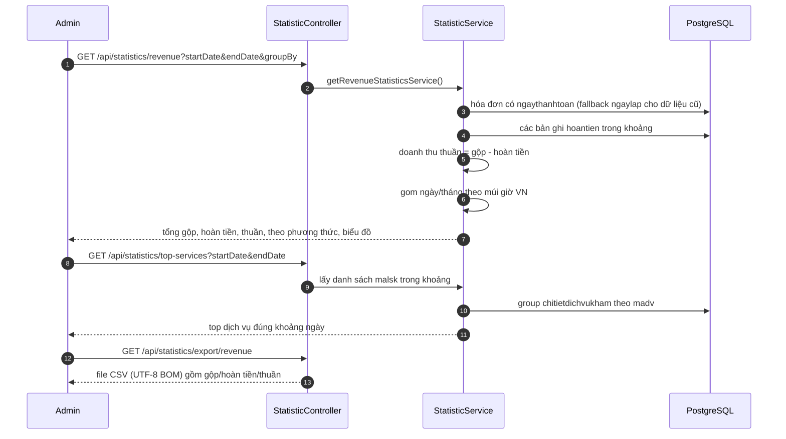

# KẾ HOẠCH KHẮC PHỤC THIẾU XÓT
## Hệ thống Quản lý Phòng khám — Backend API

> **Ngày lập:** 27/10/2026 — **cập nhật triển khai:** 27/10/2026  
> **Căn cứ:** `BAO_CAO_API_LUONG_NGHIEP_VU.md` (báo cáo kiểm tra ngày 26/10/2026)  
> **Nhánh làm việc:** `feature/khac-phuc-thieu-xot` (tách từ `develop`)  
> **Phạm vi:** backend Node.js / Express / Prisma / PostgreSQL. Không gồm frontend (hiện chưa có mã nguồn).  
> **Trạng thái:** Đã triển khai phần lớn Sprint 0–4 trong mã nguồn; **chưa commit**. Đã chạy migration + 1 kịch bản E2E trên PostgreSQL 18 cục bộ (cluster tạm, không phải Supabase); chưa chạy trên DB Supabase hiện hữu. Chi tiết thực tế ở **mục 0.5**.  
> **Lưu ý:** Đây là tài liệu nội bộ, đã khai báo trong `.gitignore`, **không commit Git** (xem mục 10).

---

## 0. TÓM TẮT ĐIỀU HÀNH

### 0.1. Mục tiêu

1. **Đóng toàn bộ lỗ hổng P0** trước khi demo/bảo vệ: phân quyền, hợp đồng đăng nhập, trigger tính tiền, chống trùng lịch, luồng lễ tân.
2. **Hoàn thiện nghiệp vụ cốt lõi** để một bệnh nhân đi trọn luồng: đăng ký → đặt lịch → tiếp đón → khám → kê đơn → lập hóa đơn → thanh toán → báo cáo.
3. **Chuẩn hóa nền tảng** để các thay đổi sau không tái phát: migration, test tự động, constants, xử lý múi giờ, tài liệu API.

### 0.2. Kết quả bàn giao

| # | Kết quả | Cách đo |
|---|---------|---------|
| 1 | 5 route hở RBAC được đóng | Ma trận test 5 vai trò × 5 route đều trả 403 đúng |
| 2 | Đăng nhập trả đúng hợp đồng | `accessToken` đọc được ở top-level; HTTP 200 |
| 3 | Hóa đơn luôn tính đúng tiền | DB mới tạo bằng migration có trigger; test thêm/xóa mục |
| 4 | Không còn 2 lịch trùng slot | Test 2 request đồng thời chỉ 1 thành công |
| 5 | Lễ tân tạo được bệnh nhân walk-in, xem slot trống, check-in, hàng chờ | UAT 10 bước |
| 6 | Có hóa đơn theo lần khám + hoàn tiền | Test API + audit |
| 7 | Tài khoản: refresh, logout, đổi mật khẩu, khóa/mở | Test bảo mật |
| 8 | Báo cáo đúng khoảng ngày + báo cáo mới + export | Đối chiếu số liệu với SQL |
| 9 | Test tự động + OpenAPI + tài liệu API cập nhật | CI xanh, Swagger chạy |

### 0.3. Khối lượng

- **33 endpoint mới** (9 P0 + 15 P1 + 9 P2) và **1 nhóm sửa RBAC** (5 route hiện có).
- **6 nhóm lỗi chính**: auth, RBAC, lịch hẹn, hóa đơn, thống kê, tài liệu.
- Ước lượng **246 giờ công** ≈ 31 ngày công ≈ **6 tuần** cho 1 dev full-time + 1 tester bán thời gian.

### 0.4. Lộ trình

| Sprint | Thời gian | Mục tiêu | Cổng kiểm soát |
|--------|-----------|----------|----------------|
| 0 | 27–29/10/2026 | Nền tảng: migration, test, constants | DB reset + test xanh |
| 1 | 30/10–07/11/2026 | P0 bảo mật & tính đúng tiền | Demo RBAC + hóa đơn + chống trùng |
| 2 | 10–19/11/2026 | P0 nghiệp vụ lễ tân | UAT luồng walk-in → thanh toán |
| 3 | 20–27/11/2026 | P1 tài khoản & bảo mật | Test refresh/logout/khóa |
| 4 | 30/11–08/12/2026 | P1 báo cáo & export | Đối chiếu số liệu |
| 5 | 09–18/12/2026 | P2, tài liệu, UAT | Nghiệm thu tổng thể |
| Dự phòng | 21–25/12/2026 | Sửa lỗi sau UAT | Go-live |

---

## 0.5. CẬP NHẬT TRIỂN KHAI & LUỒNG END-TO-END (27/10/2026)

### 0.5.1. Trạng thái thực tế theo 7 nhóm chức năng

> Cập nhật này phân biệt rõ **đã có trong mã nguồn** và **đã kiểm chứng trên CSDL thật**. Đã dựng một cluster PostgreSQL 18 tạm trên máy, chạy migration baseline + seed + **1 kịch bản E2E 14 nhóm kiểm tra** (đăng nhập, RBAC, đặt lịch, chống trùng slot, dời/hủy, tiếp đón, khám, hóa đơn, trigger, hoàn tiền, báo cáo, refresh token, khóa tài khoản, quên mật khẩu). Kết quả: **15 unit test + 1 E2E đều xanh**. Chưa chạy trên DB Supabase hiện hữu.

| # | Nhóm chức năng | Trạng thái | Đã triển khai | Còn lại / rủi ro |
|---|----------------|-----------|----------------|------------------|
| 1 | Xác thực & tài khoản | **Phần lớn hoàn thành** | Login trả `data.accessToken`, refresh token xoay vòng, logout, `/me`, đổi mật khẩu, quên/đặt lại OTP, Admin tạo/khóa/mở tài khoản, reset mật khẩu | Chưa gửi OTP qua SMS/Email thật; chỉ trả `devOtp` khi `NODE_ENV !== production`; chưa có đổi vai trò |
| 2 | Middleware & RBAC | **Hoàn thành** | JWT + kiểm tra trạng thái tài khoản trong DB, cache 15 giây, đóng 5 route hở RBAC, kiểm tra quyền sở hữu | Chưa có test tích hợp 5 vai trò × 5 route trên DB thật |
| 3 | Hồ sơ bệnh nhân | **Hoàn thành phần lễ tân** | `POST /api/patients` tạo bệnh nhân walk-in; chống trùng CCCD/BHYT; audit | Chưa có import Excel; chưa gộp hồ sơ trùng theo số điện thoại |
| 4 | Đặt lịch & chống trùng slot | **Hoàn thành phần lõi** | Slot 30 phút, tối đa 30 ngày, không đặt giờ đã qua; kiểm tra ca trực; chặn trùng bác sĩ + bệnh nhân; unique index; API slot trống | Chưa retry tự động khi 2 request đồng thời cùng slot (đã trả 409); chưa có lịch nghỉ/lễ |
| 5 | Lễ tân duyệt / hủy / tiếp đón | **Hoàn thành phần lõi** | State machine, lý do hủy bắt buộc, `DaTiepDon`, số thứ tự hàng chờ, API queue, check-in | Chưa có màn hình gọi số/loa; chưa có hủy hàng loạt |
| 6 | Hóa đơn, trigger & hoàn tiền | **Hoàn thành phần lõi** | Migration có trigger; không tin `dongia` client; `GET /invoices/by-exam/:malsk`; `ngaythanhtoan`; hủy/hoàn tiền; audit | Chưa có in hóa đơn; chưa có BHYT; chưa đối chiếu số liệu với SQL trên DB thật |
| 7 | Báo cáo & thống kê | **Phần lớn hoàn thành** | Sửa lọc ngày top dịch vụ/thuốc; doanh thu theo ngày thanh toán và trừ hoàn tiền; bệnh nhân mới; doanh thu chuyên khoa/bác sĩ; CSV | Chưa có dashboard realtime; chưa chạy đối chiếu số liệu; CSV chưa có công thức Excel |

### 0.5.2. Luồng 1 — Đăng ký, đăng nhập, refresh và logout

**Endpoint:** `POST /api/auth/register`, `POST /api/auth/login`, `POST /api/auth/refresh`, `POST /api/auth/logout`, `GET /api/auth/me`.



**Mô tả chi tiết**

1. `register` chỉ tạo tài khoản `BenhNhan`, bắt buộc họ tên, giới tính, ngày sinh hợp lệ, số điện thoại 10 chữ số.
2. `login` trả **HTTP 200** (không còn 201) và token nằm trong `data.accessToken`; không còn cảnh lồng `user.user`.
3. Refresh token là chuỗi ngẫu nhiên 48 byte, **không lưu plaintext**; DB chỉ lưu hash SHA-256. Mỗi lần refresh sẽ thu hồi token cũ và cấp token mới (rotation). Nếu token đã thu hồi bị dùng lại, toàn bộ phiên của tài khoản bị thu hồi.
4. Access token có `matk` + `vaitro`; middleware còn kiểm tra lại `trangthai` trong DB nên khóa tài khoản có hiệu lực trong tối đa 15 giây (cache), không cần chờ token hết hạn.
5. Quên mật khẩu tạo OTP 6 số, hạn 10 phút, tối đa 5 lần thử; OTP cũng chỉ lưu hash. **Chưa tích hợp SMS/Email**: ở môi trường dev, response có `devOtp` để test; production sẽ không trả OTP.

### 0.5.3. Luồng 2 — Middleware, RBAC và kiểm tra quyền sở hữu

**Endpoint tiêu biểu:** `GET /api/appointments/:id`, `PUT /api/appointments/:id/status`, `PUT /api/appointments/:id/reschedule`, `DELETE /api/appointments/:id`, `GET /api/invoices/:id`.



**Mô tả chi tiết**

- Trước đây 5 route chỉ có `authMiddleware`, bất kỳ tài khoản nào cũng đọc/sửa/hủy được lịch và xem hóa đơn của người khác. Hiện mỗi route đều có `roleMiddleware` và service kiểm tra `mabn` của bệnh nhân đang đăng nhập.
- Bệnh nhân chỉ được hủy lịch của mình; không được xác nhận, tiếp đón hay đánh dấu đã khám.
- Lễ tân/Admin được xác nhận, tiếp đón, hủy; bác sĩ được đánh dấu đã khám; mọi thay đổi trạng thái phải đúng state machine.
- Tài khoản bị khóa bị chặn ngay cả khi access token cũ còn hạn.

### 0.5.4. Luồng 3 — Bệnh nhân đặt lịch và chống trùng slot

**Endpoint:** `GET /api/appointments/available-slots`, `POST /api/appointments`, `GET /api/appointments/my-appointments`.



**Mô tả chi tiết**

- Slot mặc định **30 phút**, cấu hình bằng `SLOT_MINUTES`; tối đa đặt trước **30 ngày** (`MAX_ADVANCE_DAYS`); có thể đặt trong ngày nếu còn slot.
- Chống trùng theo **hai chiều**: một bác sĩ không có 2 lịch cùng slot; một bệnh nhân không có 2 lịch cùng slot. Các trạng thái còn giữ chỗ: `ChoXacNhan`, `DaXacNhan`, `DaTiepDon`.
- DB có partial unique index `uq_lichhen_bacsi_slot_active` và `uq_lichhen_benhnhan_slot_active`, nên kể cả 2 request đồng thời cũng chỉ 1 request thắng; request còn lại nhận lỗi `P2002` được chuyển thành HTTP 409.
- Lịch do bệnh nhân tự đặt có trạng thái `ChoXacNhan`; lịch do lễ tân/Admin đặt tại quầy có trạng thái `DaXacNhan`.

### 0.5.5. Luồng 4 — Lễ tân: tạo bệnh nhân → đặt lịch → tiếp đón → hàng chờ

**Endpoint:** `POST /api/patients`, `POST /api/appointments`, `PATCH /api/appointments/:id/check-in`, `GET /api/appointments/queue`.



**Mô tả chi tiết**

- Bệnh nhân walk-in không cần tài khoản portal: `benhnhan.matk` để `NULL`. Lễ tân có thể tạo hồ sơ rồi đặt lịch ngay.
- Check-in chỉ cho lịch `DaXacNhan`; hệ thống cấp số thứ tự tăng dần theo **ngày + bác sĩ**, lưu `sohangcho` và `thoigiantiepdon`. Unique index chống trùng số thứ tự.
- Hàng chờ trả cả bệnh nhân đã xác nhận (chưa tới), đã tiếp đón và đã khám, sắp xếp theo số thứ tự để lễ tân gọi.
- Khi bác sĩ tạo phiếu khám, `lichhen.trangthai` chuyển `DaKham`.

### 0.5.6. Luồng 5 — Bác sĩ khám và liên kết lần khám với lịch hẹn

**Endpoint:** `POST /api/examinations`, `GET /api/examinations/...`.



**Mô tả chi tiết**

- `lichsukham.malh` là FK unique (1-1) về `lichhen`, cho phép truy vết lần khám ↔ lịch hẹn. Trước đây phiếu khám không lưu `malh` nên không biết lần khám thuộc lịch nào.
- Chỉ được liên kết lịch hẹn thuộc đúng bệnh nhân, đang ở `DaXacNhan` hoặc `DaTiepDon`; lịch đã hủy/đã khám bị từ chối. Bác sĩ chỉ tạo được phiếu cho lịch do mình phụ trách; Admin được chỉ định bác sĩ.
- Tạo phiếu khám và cập nhật lịch hẹn nằm trong một transaction.

### 0.5.7. Luồng 6 — Hóa đơn, trigger tính tiền, thanh toán và hoàn tiền

**Endpoint:** `POST /api/invoices`, `POST /api/invoices/:id/items`, `DELETE /api/invoices/:id/items/:itemId`, `PUT /api/invoices/:id/pay`, `GET /api/invoices/by-exam/:malsk`, `POST /api/invoices/:id/refund`, `PUT /api/invoices/:id/cancel`.



**Mô tả chi tiết**

- `tongtien` do trigger PostgreSQL tính từ `chitiethoadon`, không phụ thuộc client. Migration baseline tạo trigger `trg_cthd_update_tongtien`; `npm run db:check-trigger` kiểm tra trigger và index.
- Giá dịch vụ/thuốc luôn lấy từ bảng danh mục; client không được override `dongia`. Đây là lỗ hổng gian lận giá đã được đóng.
- Thanh toán lưu `ngaythanhtoan` để báo cáo doanh thu theo ngày tiền thực thu, không dùng ngày lập hóa đơn.
- Hủy hóa đơn chưa thanh toán: chỉ đổi `DaHuy`. Hủy hóa đơn đã thanh toán: chỉ Admin, tạo bản ghi hoàn tiền phần còn lại. Hoàn tiền một phần cũng chỉ Admin và không vượt quá số đã thu.
- `GET /api/invoices/by-exam/:malsk` giúp thu ngân tìm hóa đơn từ lần khám mà không cần biết `mahd`.

### 0.5.8. Luồng 7 — Báo cáo thống kê và xuất dữ liệu

**Endpoint:** `GET /api/statistics/overview`, `/revenue`, `/examinations`, `/top-services`, `/top-medicines`, `/patients`, `/revenue-by-specialty`, `/revenue-by-doctor`, `/export/revenue`.



**Mô tả chi tiết**

- Các báo cáo top dịch vụ/top thuốc **đã áp dụng `startDate/endDate`**; trước đây bỏ qua tham số này.
- Doanh thu dùng `ngaythanhtoan` (fallback `ngaylap` cho dữ liệu cũ) và **trừ hoàn tiền**, nên số "doanh thu thuần" khớp tiền thực thu.
- Mặc định khoảng báo cáo là 30 ngày gần nhất theo múi giờ Việt Nam; mọi mốc ngày dùng helper `date.js`, tránh lệch ngày 00:00–07:00.
- Báo cáo bệnh nhân mới thống kê theo giới tính và nhóm tuổi; doanh thu theo chuyên khoa/bác sĩ lấy từ hóa đơn đã thanh toán và chi tiết dịch vụ.

### 0.5.9. Phạm vi chưa hoàn thành / cần kiểm chứng

| Hạng mục | Trạng thái | Ghi chú |
|----------|-----------|---------|
| Integration test trên PostgreSQL | **Đã chạy** | 1 kịch bản E2E 14 nhóm kiểm tra trên PostgreSQL 18 cluster tạm; 15 unit test + 1 E2E xanh |
| Migration trên DB Supabase hiện hữu | **Chưa chạy** | Mới chạy trên DB trống; cần backup/clone và kiểm tra tên bảng thực tế là chữ thường hay PascalCase trước khi áp dụng |
| OpenAPI/Swagger | **Chưa làm** | Hợp đồng API hiện mô tả trong tài liệu này; sẽ sinh OpenAPI ở Sprint 5 |
| In hóa đơn PDF | **Chưa làm** | Chưa có mẫu in/định dạng |
| BHYT/bảo hiểm | **Chưa làm** | Cần chốt tỷ lệ, mã thẻ, quy trình |
| OTP qua SMS/Email | **Chưa làm** | Hiện chỉ trả `devOtp` ở môi trường dev |
| Audit toàn bộ thao tác | **Một phần** | Đã ghi đặt/hủy/đổi trạng thái lịch, tạo bệnh nhân, tạo/khóa tài khoản, hoàn tiền |
| Đổi vai trò tài khoản | **Chưa làm** | Chỉ có khóa/mở, tạo mới, reset mật khẩu |
| UAT 10 bước luồng lễ tân | **Chưa chạy** | Cần DB test và dữ liệu mẫu |
| Commit/PR | **Chưa commit** | Toàn bộ thay đổi đang ở nhánh `feature/khac-phuc-thieu-xot` |

### 0.5.10. Lệnh kiểm tra sau khi có `.env` và DB

```bash
cd backend
npm test                       # 15 unit test, không cần DB
npm run db:migrate             # áp dụng baseline + trigger + index
npm run db:seed                # tạo Admin + dữ liệu tối thiểu
npm run db:check-trigger       # kiểm tra trigger/index
npm run test:integration       # 1 E2E trên DB test (cần DATABASE_URL)
curl http://localhost:5000/api/health/db
```

> Nếu DB đang có dữ liệu thật: **không chạy `db:migrate` ngay**. Làm theo `backend/prisma/migrations/README.md` (backup → kiểm tra tên bảng → tạo migration nâng cấp từ DB thật → kiểm tra trùng slot → `migrate resolve` baseline → `migrate deploy`).

---

## 1. HIỆN TRẠNG & ĐIỀU KIỆN TIÊN QUYẾT

### 1.1. Năm điểm nghẽn phải xử lý trước

> Bảng dưới đây ghi **hiện trạng lúc lập kế hoạch**. Trạng thái sau triển khai (đã xử lý đến đâu) xem **mục 0.5**.

| # | Điểm nghẽn | Ảnh hưởng | Cách xử lý |
|---|-----------|-----------|------------|
| 1 | **Chưa có `prisma/migrations`** | Không thể thay đổi schema an toàn; trigger chỉ nằm trong file SQL rời | Sprint 0 tạo baseline migration + đưa trigger vào migration |
| 2 | **Chưa có test tự động** | Mọi sửa lỗi đều phải kiểm tra tay; dễ tái phát | Sprint 0 dựng test runner (đã dùng `node:test`) + DB test riêng |
| 3 | **Trigger tính tiền ngoài migration** | Deploy bằng `prisma db push` sẽ mất trigger, `tongtien` = 0 | Migration baseline + script kiểm tra trigger khi khởi động |
| 4 | **Frontend chưa có mã nguồn** (chỉ `node_modules` + `.gitkeep`) | Không có ràng buộc tương thích ngược | **Chốt hợp đồng API ngay sprint 0**, sửa response đăng nhập không cần cầu nối |
| 5 | **DB thật trên Supabase** | Migration sai có thể mất dữ liệu | Clone DB, chạy thử migration trên clone trước; luôn có dump |

### 1.2. Điều kiện tiên quyết

- [x] Chủ dự án đã duyệt kế hoạch (“tốt thực hiện plan đi”, 27/10/2026). Các câu hỏi nghiệp vụ còn lại (mục 14) sẽ chốt trong UAT.
- [ ] Có quyền truy cập Supabase (đọc/ghi) và một DB clone — **chưa có**; đã dùng cluster PostgreSQL 18 tạm để test.
- [x] Tạm chốt slot 30 phút và hoàn tiền một phần chỉ Admin (theo đề xuất); có thể đổi bằng biến môi trường/constant.
- [x] Đã dùng trạng thái `DaTiepDon` và số thứ tự hàng chờ (`sohangcho`), có unique index chống trùng.

---

## 2. NGUYÊN TẮC THỰC HIỆN

1. **Mỗi sprint phải release được.** Không gộp 2 sprint vào một lần deploy.
2. **Schema chỉ đổi qua migration.** Không sửa tay trên Supabase, không dùng `db push` cho môi trường có dữ liệu.
3. **Không phá hợp đồng API đang dùng.** Vì frontend chưa có code, được phép chốt lại ngay sprint 0; sau đó mọi thay đổi breaking phải qua version hoặc giai đoạn chuyển tiếp.
4. **Test trước, merge sau.** Mỗi task P0 phải có ít nhất 1 test tích hợp; bug fix phải có test tái hiện.
5. **Một task – một PR nhỏ.** Nhánh `feature/<mã-task>` từ `develop`, review chéo rồi merge.
6. **Không commit tài liệu nội bộ.** Các file báo cáo/kế hoạch nằm trong `.gitignore`.
7. **Không đưa secret vào tài liệu.** Không dán `JWT_SECRET`, chuỗi kết nối DB, mật khẩu Supabase vào báo cáo hay test.

### Definition of Done (DoD) cho mỗi task

- [ ] Code chạy local, không lỗi lint (nếu có).
- [ ] Có test (unit hoặc integration) và test xanh.
- [ ] Đã cập nhật tài liệu API/Swagger nếu thay đổi hợp đồng.
- [ ] Đã kiểm tra phân quyền cho mọi role liên quan.
- [ ] Đã kiểm tra ảnh hưởng dữ liệu cũ (migration/backfill).
- [ ] PR được review và merge vào `develop`.

---

## 3. SPRINT 0 — NỀN TẢNG (24 giờ)

**Mục tiêu:** có thể tạo lại DB từ đầu bằng một lệnh, có test tự động, có constants dùng chung, chốt hợp đồng API.

| ID | Việc | File / đối tượng | Giờ | Phụ thuộc | Nghiệm thu |
|----|------|------------------|:---:|-----------|------------|
| S0-01 | Sao lưu & clone DB | Supabase dashboard, `backend/.env` | 4 | — | Clone chạy được, có file dump |
| S0-02 | Baseline migration + trigger | `backend/prisma/migrations/`, `backend/package.json` | 8 | S0-01 | `prisma migrate reset` tạo đủ bảng + trigger; `npm run db:seed` chạy |
| S0-03 | Constants & utils dùng chung | `backend/src/constants/`, `backend/src/utils/date.js`, `slot.js` | 4 | — | Không còn chuỗi role/trạng thái rải rác ở 3 module trọng yếu |
| S0-04 | Test harness | `backend/tests/`, `backend/package.json` | 6 | S0-02 | `npm test` chạy 1 test RBAC mẫu; DB test tách riêng |
| S0-05 | Chốt hợp đồng API | `docs/api-contract.md` (nội bộ) | 2 | — | Bảng method/path/request/response cho 5 module |

**Cách làm S0-02 (quan trọng nhất)**

1. Sinh migration baseline từ schema:
   ```bash
   npx prisma migrate diff --from-empty --to-schema prisma/schema.prisma --script \
     -o prisma/migrations/20261027000000_init/migration.sql
   ```
   (Không dùng `migrate dev` khi chưa có DB; cách này đã dùng thực tế.)
2. Mở file migration, bổ sung phần trigger:
   - `CREATE OR REPLACE FUNCTION fn_update_tongtien_hoadon()`
   - `CREATE TRIGGER trg_cthd_update_tongtien AFTER INSERT OR UPDATE OR DELETE ON "chitiethoadon" ...`
   - Tên bảng/cột thực tế là **chữ thường** (`hoadon`, `chitiethoadon`, `mahd`, `dongia`) vì schema không dùng `@@map`. Kiểm tra bằng `\dt` trước khi viết.
   - **Bắt buộc sửa cột `thanhtien`**: Prisma sinh `DEFAULT ((soluong)::numeric * dongia)` (PostgreSQL báo `cannot use column reference in DEFAULT expression`); phải đổi thành `GENERATED ALWAYS AS ((soluong)::numeric * dongia) STORED`. Đã gặp và sửa lỗi này khi chạy migration thật.
3. Với DB Supabase đang có dữ liệu: dùng `prisma migrate diff --from-url ... --to-schema` để tạo **migration nâng cấp**, đánh dấu baseline đã tồn tại bằng `prisma migrate resolve --applied 20261027000000_init`, rồi `prisma migrate deploy` để áp dụng phần nâng cấp. Không chỉ resolve baseline mà bỏ qua migration nâng cấp. Xem `backend/prisma/migrations/README.md`.
4. Thêm script kiểm tra trigger:
   - `GET /api/health/db` trả `triggerTinhTien: true/false`.
   - `npm run db:check-trigger` kiểm tra trigger + 3 unique index.
5. Backfill dữ liệu cũ (nếu bảng PascalCase, giữ nguyên tên cột gốc):
   ```sql
   UPDATE "HoaDon" h
   SET "TongTien" = COALESCE((
     SELECT SUM(ct."ThanhTien")
     FROM "ChiTietHoaDon" ct
     WHERE ct."MaHD" = h."MaHD"
   ), 0);
   ```

**Cách làm S0-03**

- `src/constants/roles.js`: `ADMIN`, `BACSI`, `YTA`, `LETAN`, `BENHNHAN`.
- `src/constants/appointmentStatus.js`: 4 trạng thái + bảng chuyển trạng thái hợp lệ.
- `src/utils/date.js`: `todayVN()`, `toDateOnly()`, `isPastDate()` dùng múi giờ `Asia/Ho_Chi_Minh`.
- `src/utils/slot.js`: `toSlotIndex(time, slotMinutes)`, `fromSlotIndex(index)`, `isAlignedToSlot()`.

**Cách làm S0-04**

- Dùng test runner có sẵn của Node 22 (`node:test`), không cài Jest/Supertest.
- Tạo DB test riêng (ví dụ `quanlyphongkham_test`), chạy migration + seed trước bộ E2E.
- Unit test thuần cho helper; E2E dùng `fetch` gọi HTTP thật. Mẫu đã có: `GET /api/statistics/overview` với token bệnh nhân → 403.

**Điều kiện thoát Sprint 0**

```bash
cd backend
npm run db:migrate     # hoặc npx prisma migrate deploy
npm run db:seed
npm test
```

Cả 3 lệnh phải xanh trên máy sạch; DB mới có trigger; tài liệu hợp đồng API được duyệt.

---

## 4. SPRINT 1 — P0 BẢO MẬT & TÍNH ĐÚNG TIỀN (44 giờ)

**Mục tiêu:** đóng lỗ hổng phân quyền, sửa hợp đồng đăng nhập, bảo đảm hóa đơn luôn đúng tiền, chống trùng slot thực sự, chặn chuyển trạng thái sai.

| ID | Việc | File chính | Giờ | Phụ thuộc |
|----|------|------------|:---:|-----------|
| S1-01 | Đóng RBAC 5 route | `appointment.router.js`, `invoice.router.js` | 4 | S0-04 |
| S1-02 | Chuẩn hóa hợp đồng Auth + `/auth/me` | `auth.controller.js`, `auth.service.js`, `auth.router.js` | 6 | S0-03 |
| S1-03 | Trigger trong migration + health check | `migrations/`, `src/routes/health` | 6 | S0-02 |
| S1-04 | Slot engine + unique index + transaction | `appointment.service.js`, `utils/slot.js`, migration | 12 | S0-03 |
| S1-05 | State machine + lý do hủy | `appointment.service.js`, `constants/`, migration | 8 | S1-04 |
| S1-06 | Chuẩn hóa múi giờ | `utils/date.js`, `appointment.validator.js`, `statistic.service.js` | 4 | S0-03 |
| S1-07 | Regression + release 0.2.0 | `tests/`, `CHANGELOG.md` | 4 | S1-01…06 |

### 4.1. S1-01 — Đóng RBAC (4 giờ)

**Ma trận chốt (thay thế đề xuất nháp trong báo cáo):**

| Endpoint | Admin | BacSi | YTa | LeTan | BenhNhan |
|----------|:-----:|:-----:|:---:|:-----:|:--------:|
| `GET /appointments/:id` | ✅ | ✅ | ✅ (chỉ đọc) | ✅ | ✅ của mình |
| `PUT /appointments/:id/status` | ✅ | ✅ | — | ✅ | — |
| `PUT /appointments/:id/reschedule` | ✅ | ✅ | — | ✅ | ✅ của mình |
| `PUT /appointments/:id/cancel` (mới) | ✅ | ✅ | — | ✅ | ✅ của mình |
| `DELETE /appointments/:id` (deprecated) | ✅ | ✅ | — | ✅ | ✅ của mình |
| `GET /invoices/:id` | ✅ | — | — | ✅ | ✅ của mình |

Bệnh nhân hủy lịch qua `PUT /appointments/:id/cancel` (S1-05), **không** dùng `/status`.

**Cách làm**

1. Thêm `roleMiddleware(...)` đúng ma trận vào 5 route đang hở.
2. Giữ kiểm tra sở hữu trong service cho `BenhNhan`; trả `403` thay vì `404` khi biết bản ghi tồn tại nhưng không thuộc người gọi.
3. Viết test ma trận: 5 role × 6 endpoint, khẳng định đúng `200/403/404`.
4. Test riêng: YTa gọi 4 route ghi → `403`; bệnh nhân A sửa lịch bệnh nhân B → `403`.

**Nghiệm thu:** không còn route nào chỉ có `authMiddleware` mà thiếu kiểm tra vai trò/sở hữu; test ma trận xanh.

### 4.2. S1-02 — Hợp đồng Auth (6 giờ)

**Hợp đồng mới (áp dụng ngay vì frontend chưa có code):**

`POST /api/auth/login` → `200`

```json
{
  "success": true,
  "message": "Đăng nhập thành công",
  "data": {
    "accessToken": "<jwt>",
    "tokenType": "Bearer",
    "expiresIn": "1d",
    "user": {
      "matk": 1,
      "tendangnhap": "benhnhan01",
      "vaitro": "BenhNhan",
      "trangthai": "HoatDong",
      "mabn": 1,
      "manv": null
    }
  }
}
```

`POST /api/auth/register` → `201` với `data: { matk, mabn, tendangnhap, vaitro }`.

`GET /api/auth/me` (mới) → trả hồ sơ đầy đủ: tài khoản + `mabn` (nếu là bệnh nhân) hoặc `manv`, `mabs`, `mack`, `chucvu` (nếu là nhân viên).

**Việc phải làm**

1. Bỏ lớp lồng `user.user`; trả `accessToken` ở `data.accessToken`.
2. Đổi `loginController` từ `201` sang `200`.
3. Thêm `success: true` cho register/login (đồng bộ envelope).
4. Thêm service `getMeService(matk)` và route `/me`.
5. Xóa hoặc ẩn 2 route demo `/admin-only`, `/patient-only` trước khi go-live (giữ lại trong môi trường dev nếu cần).
6. Cập nhật `API_FRONTEND_GUIDE.md` theo hợp đồng mới.

**Nghiệm thu:** Postman login đọc được `data.accessToken`; `/me` trả đúng `mabn`/`manv`; test 200/401.

### 4.3. S1-03 — Trigger & health check (6 giờ)

1. Xác nhận tên bảng/cột thực tế trên DB:
   ```sql
   SELECT table_name, column_name
   FROM information_schema.columns
   WHERE table_schema = 'public'
     AND table_name IN ('hoadon','HoaDon','chitiethoadon','ChiTietHoaDon')
   ORDER BY table_name, ordinal_position;
   ```
2. Viết trigger trong migration theo **đúng tên thực tế**. Lưu ý: schema Prisma không dùng `@@map`, nên bảng mặc định là chữ thường (`hoadon`, `chitiethoadon`) trong khi file SQL tham khảo dùng PascalCase (`HoaDon`) — phải chốt trước khi viết.
3. Thêm `GET /api/health/db` trả:
   ```json
   { "success": true, "data": { "database": "ok", "trigger_tongtien": true } }
   ```
4. Thêm script `npm run db:recompute-totals` chạy câu UPDATE ở mục 3.
5. Test tích hợp:
   - Tạo hóa đơn → thêm 2 mục 50.000 → `tongtien = 100000`.
   - Xóa 1 mục → `tongtien = 50000`.
   - Sửa `soluong` → trigger cập nhật lại.
   - Chạy trên DB mới tạo bằng migration (không dùng DB đã sửa tay).

**Nghiệm thu:** DB tạo mới từ migration có trigger; test tổng tiền xanh; health check báo đúng.

### 4.4. S1-04 — Slot engine & chống trùng (12 giờ)

**Cấu hình**

| Biến | Mặc định | Ý nghĩa |
|------|----------|---------|
| `SLOT_MINUTES` | `30` | Độ dài một slot khám |
| `MAX_ADVANCE_DAYS` | `30` | Được đặt trước tối đa bao nhiêu ngày |
| `MIN_LEAD_MINUTES` | `0` | Phải đặt trước ít nhất bao nhiêu phút |

**Thuật toán mới cho `createAppointmentService` và `rescheduleAppointmentService`**

1. Chuẩn hóa `ngayhen` theo `Asia/Ho_Chi_Minh`; chặn ngày quá khứ, quá `MAX_ADVANCE_DAYS`.
2. Chuẩn hóa `giohen`; bắt buộc `phút % SLOT_MINUTES === 0`, nếu không → `400`.
3. Kiểm tra ca trực như hiện tại (giữ nguyên logic).
4. Kiểm tra trùng bác sĩ **và** trùng bệnh nhân theo `(ngayhen, giohen)` với trạng thái `ChoXacNhan`, `DaXacNhan`.
5. Tạo/dời lịch trong transaction; bắt lỗi unique `23505`/`P2002` → `409` thân thiện.
6. Với reschedule: kiểm tra trùng bệnh nhân (đang thiếu), loại trừ chính bản ghi.

**Unique index (PostgreSQL partial index — phải viết tay trong migration)**

```sql
-- Thay tên bảng/cột theo DB thực tế
CREATE UNIQUE INDEX uq_lichhen_bacsi_slot_active
ON lichhen (mabs, ngayhen, giohen)
WHERE trangthai IN ('ChoXacNhan', 'DaXacNhan');

CREATE UNIQUE INDEX uq_lichhen_benhnhan_slot_active
ON lichhen (mabn, ngayhen, giohen)
WHERE trangthai IN ('ChoXacNhan', 'DaXacNhan');
```

**Trước khi tạo index phải dọn dữ liệu trùng:**

```sql
SELECT mabs, ngayhen, giohen, COUNT(*)
FROM lichhen
WHERE trangthai IN ('ChoXacNhan','DaXacNhan')
GROUP BY mabs, ngayhen, giohen
HAVING COUNT(*) > 1;
```

**Test bắt buộc**

- `08:00` và `08:15` → request `08:15` bị `400` (lệch slot).
- `08:00` và `08:30` cùng bác sĩ → `409`.
- Cùng bệnh nhân, cùng giờ, khác bác sĩ → `409`.
- 2 request đồng thời cùng slot → đúng 1 thành công, 1 nhận `409` (dùng `Promise.allSettled`).
- Reschedule sang slot bệnh nhân đã có lịch → `409`.

### 4.5. S1-05 — State machine & lý do hủy (8 giờ)

**Bảng chuyển trạng thái hợp lệ (giai đoạn 1, chưa có `DaTiepDon`)**

| Từ | Đến | Ai được làm |
|----|-----|-------------|
| `ChoXacNhan` | `DaXacNhan` | Admin, LeTan, BacSi |
| `ChoXacNhan` | `DaHuy` | Admin, LeTan, BacSi, bệnh nhân sở hữu |
| `DaXacNhan` | `DaKham` | Admin, BacSi (hoặc tự động khi tạo phiếu khám) |
| `DaXacNhan` | `DaHuy` | Admin, LeTan, BacSi, bệnh nhân sở hữu |
| `DaKham` | — | Không được đổi |
| `DaHuy` | — | Không được đổi |

**Thay đổi DB**

```sql
ALTER TABLE lichhen ADD COLUMN lydohuy VARCHAR(255);
ALTER TABLE lichhen ADD COLUMN thoigianhuy TIMESTAMP(6);
```

**API**

- `PUT /api/appointments/:id/cancel` — body bắt buộc `{ "lydohuy": "..." }`, độ dài 5–255.
- `DELETE /api/appointments/:id` giữ lại 1 sprint, gọi cùng service với lý do mặc định và trả header `Deprecation: true`.
- Cập nhật `GET` trả thêm `lydohuy`, `thoigianhuy`.

**Nghiệm thu:** mọi chuyển trạng thái sai trả `400`; hủy thiếu lý do trả `400`; lý do lưu đúng; lịch đã hủy không thể hồi sinh.

### 4.6. S1-06 — Chuẩn hóa múi giờ (4 giờ)

- Thay mọi `new Date().toISOString().split("T")[0]` bằng `todayVN()`.
- Thay `new Date("YYYY-MM-DD")` bằng `parseDateOnly()` (tạo `Date` tại `00:00` giờ VN, không phải UTC).
- Áp dụng cho: `appointment.service.js`, `appointment.validator.js`, `statistic.service.js`, `invoice.service.js`.
- Test vào lúc `00:30` giờ VN: đặt lịch "hôm nay" phải được chấp nhận; báo cáo "hôm nay" phải tính đúng ngày.
- Ghi rõ trong README: server production nên đặt `TZ=Asia/Ho_Chi_Minh`, nhưng code không phụ thuộc biến này.

### 4.7. S1-07 — Regression & release (4 giờ)

- Chạy toàn bộ test + Postman collection.
- Kiểm tra lại 5 luồng: đăng ký, đăng nhập, đặt lịch, duyệt, hủy.
- Gắn tag `v0.2.0`, ghi `CHANGELOG.md`.
- **Cổng ra:** demo 10 phút cho chủ dự án: RBAC bị chặn, login đọc token, hóa đơn đúng tiền, 2 request đồng thời chỉ 1 thành công.

---

## 5. SPRINT 2 — P0 NGHIỆP VỤ LỄ TÂN (56 giờ)

**Mục tiêu:** lễ tân có thể tạo bệnh nhân mới, xem giờ trống, tiếp đón, cấp số thứ tự, lập hóa đơn theo lần khám và hoàn tiền.

| ID | Việc | File / DB | Giờ | Phụ thuộc |
|----|------|-----------|:---:|-----------|
| S2-01 | `POST /api/patients` tạo bệnh nhân walk-in | `patient.router/controller/service/validator` | 8 | S0-04 |
| S2-02 | `GET /api/appointments/available-slots` | `appointment.*`, `utils/slot.js` | 8 | S1-04 |
| S2-03 | `DaTiepDon` + check-in + hàng chờ | schema, `appointment.*` | 16 | S1-05 |
| S2-04 | Liên kết lần khám ↔ lịch hẹn (`lichsukham.malh`) | schema, `examination.service.js` | 8 | S2-03 |
| S2-05 | Hóa đơn theo lần khám + hoàn tiền | schema, `invoice.*` | 12 | S1-03 |
| S2-06 | UAT luồng lễ tân đầu-cuối | `tests/e2e`, checklist | 4 | S2-01…05 |

### 5.1. S2-01 — Tạo bệnh nhân walk-in (8 giờ)

**Endpoint mới**

```http
POST /api/patients
Authorization: Bearer <Admin|LeTan>
Content-Type: application/json

{
  "hoten": "Nguyen Van B",
  "gioitinh": "Nam",
  "ngaysinh": "1995-05-20",
  "sdt": "0912345678",
  "diachi": "123 ABC, Quan 1",
  "cccd": "012345678901",
  "sobhyt": "DN4012345678901"
}
```

- Trả `201` với `{ success, message, data: { mabn, hoten, ... } }`.
- `matk = null` (không tạo tài khoản).
- Trùng `cccd` hoặc `sobhyt` → `409` kèm mã đã tồn tại.
- `sdt` không unique (nhiều bệnh nhân có thể dùng chung số người thân), nhưng cảnh báo trùng mềm trong response.
- Validator dùng lại `validateUpdateProfile` + bổ sung `hoten`, `gioitinh`, `ngaysinh` bắt buộc.
- Không cho `BenhNhan` gọi (đã có `/register`).

**Test:** tạo thành công; thiếu trường → 400; CCCD trùng → 409; LeTan gọi được, YTa → 403.

### 5.2. S2-02 — API khung giờ trống (8 giờ)

```http
GET /api/appointments/available-slots?mabs=1&date=2026-11-01&slotMinutes=30
```

- Public (không cần token) để trang đặt lịch hiển thị trước khi đăng nhập.
- Validate: `mabs` tồn tại; `date` không quá khứ, không quá `MAX_ADVANCE_DAYS`; `slotMinutes` ∈ {15, 20, 30, 60}.
- Trả toàn bộ slot của **các ca trực trong ngày**, mỗi slot kèm `available` và `lydo` nếu bị chặn:

```json
{
  "success": true,
  "data": {
    "mabs": 1,
    "date": "2026-11-01",
    "slotMinutes": 30,
    "slots": [
      { "giohen": "08:00", "available": true },
      { "giohen": "08:30", "available": false, "lydo": "DaCoLich" },
      { "giohen": "09:00", "available": false, "lydo": "DaQua" }
    ]
  }
}
```

- Nếu không có ca trực: `data.slots = []` + `message` giải thích.
- Không trả thông tin bệnh nhân khác (chỉ trạng thái slot).

**Test:** ngày có 2 ca sáng/chiều; ca qua giờ; ngày nghỉ; ngày quá khứ; slot lệch 15 phút.

### 5.3. S2-03 — Tiếp đón & hàng chờ (16 giờ)

**Schema (3 migration nhỏ, không gộp)** — tên bảng/cột dưới đây theo Prisma; đối chiếu `information_schema` trước khi chạy.

```sql
-- Migration 1: thêm giá trị enum (PostgreSQL 12+; nếu lỗi, tách file riêng)
ALTER TYPE trang_thai_lichhen_enum ADD VALUE IF NOT EXISTS 'DaTiepDon' AFTER 'DaXacNhan';

-- Migration 2: cột
ALTER TABLE lichhen ADD COLUMN thoigiantiepdon TIMESTAMP(6);
ALTER TABLE lichhen ADD COLUMN sohangcho INT;

-- Migration 3: chống trùng số thứ tự trong ngày
CREATE UNIQUE INDEX uq_lichhen_ngay_bacsi_sohangcho
ON lichhen (mabs, ngayhen, sohangcho);
```

**API**

- `PATCH /api/appointments/:id/check-in` — Admin, LeTan.
  - Chỉ cho `DaXacNhan → DaTiepDon`.
  - Ghi `thoigiantiepdon = now()`, cấp `sohangcho = MAX(sohangcho)+1` theo `(mabs, ngayhen)` trong transaction.
  - Unique index bảo vệ trường hợp đồng thời; hiện **chưa tự retry** nếu đụng index (trả lỗi để client thử lại).
  - Check-in lần 2 → `400`.
- `GET /api/appointments/queue?date=2026-11-01&mabs=1` — Admin, LeTan, BacSi (chỉ đọc).
  - Sắp theo `sohangcho`, trả `sohangcho, giohen, hoten, trangthai, thoigiantiepdon`.
  - Mặc định `date = hôm nay` theo giờ VN.

**Cập nhật state machine**

```
DaXacNhan ──► DaTiepDon ──► DaKham
      │            │
      └────────────┴──► DaHuy
```

- Hủy được từ `DaTiepDon` bởi Admin/LeTan (bệnh nhân rời quầy).
- Không cho `DaTiepDon → DaXacNhan`.

**Test:** check-in đúng; check-in 2 lần → 400; STT tăng dần; sang ngày mới STT reset; hàng chờ sắp đúng; hủy từ `DaTiepDon`.

### 5.4. S2-04 — Liên kết lần khám với lịch hẹn (8 giờ)

**Lý do:** hiện `lichsukham` **không có `malh`**, nên không biết lần khám nào sinh ra từ lịch hẹn nào; không thể đối chiếu hàng chờ, hóa đơn, thống kê theo lịch.

```sql
ALTER TABLE lichsukham ADD COLUMN malh INT UNIQUE;
ALTER TABLE lichsukham
  ADD CONSTRAINT fk_lichsukham_lichhen
  FOREIGN KEY (malh) REFERENCES lichhen(malh)
  ON DELETE SET NULL;
```

**Cách làm**

1. Thêm `malh Int? @unique` vào model `lichsukham` (Prisma).
2. `createExaminationService`:
   - Nếu có `malh`: kiểm tra lịch thuộc đúng `mabn`, trạng thái `DaTiepDon` hoặc `DaXacNhan`.
   - Lưu `malh` vào `lichsukham`.
   - Sau khi tạo phiếu, cập nhật lịch `DaKham` như hiện tại.
   - Nếu lịch đã có phiếu khám → `409`.
3. Trả `malh` trong response phiếu khám và danh sách.
4. Backfill: để `NULL` cho dữ liệu cũ; không đoán.

**Test:** tạo phiếu có `malh` → lịch `DaKham`; `malh` của bệnh nhân khác → 403/400; tạo lần 2 → 409.

### 5.5. S2-05 — Hóa đơn theo lần khám & hoàn tiền (12 giờ)

**API 1:** `GET /api/invoices/by-exam/:malsk` - Admin, LeTan; bệnh nhân chỉ xem hóa đơn của chính mình.
- Trả hóa đơn kèm chi tiết; `404` nếu chưa lập.
- Đặt route **trước** `/:id` để không bị bắt nhầm.

**API 2:** `POST /api/invoices/:id/refund` — Admin.

```sql
CREATE TABLE hoantien (
  maht     SERIAL PRIMARY KEY,
  mahd     INT NOT NULL REFERENCES hoadon(mahd),
  sotien   DECIMAL(14,2) NOT NULL CHECK (sotien > 0),
  lydo     VARCHAR(255) NOT NULL,
  matk     INT NOT NULL REFERENCES taikhoan(matk),
  thoigian TIMESTAMP(6) NOT NULL DEFAULT now()
);
```

- Chỉ hoàn cho hóa đơn `DaThanhToan`.
- `tổng đã hoàn + sotien <= tongtien`, nếu vượt → `400`.
- Chạy trong transaction; ghi audit (Sprint 5).
- Trả `{ tongtien, dahoan, conlai }`.
- Hủy hóa đơn đã thanh toán: **bắt buộc** đi qua hoàn tiền; `PUT /:id/cancel` trên hóa đơn đã thu tiền trả `400` kèm hướng dẫn.

**Test:** hoàn một phần; hoàn vượt; hoàn 2 lần vượt tổng; hoàn hóa đơn chưa thu → 400; LeTan gọi refund → 403.

### 5.6. S2-06 — UAT luồng lễ tân (4 giờ)

Kịch bản 10 bước, chạy trên dữ liệu seed:

1. Lễ tân tạo bệnh nhân walk-in.
2. Chọn bác sĩ + ngày, xem slot trống.
3. Đặt lịch hộ bệnh nhân (trạng thái `DaXacNhan`).
4. Check-in → có STT.
5. Hàng chờ hiển thị đúng thứ tự.
6. Bác sĩ tạo phiếu khám từ lịch.
7. Kê đơn + chỉ định dịch vụ.
8. Lập hóa đơn theo `malsk`.
9. Thu tiền → `DaThanhToan`; `tongtien` khớp.
10. Hoàn tiền một phần → số dư đúng; báo cáo doanh thu trừ phần hoàn.

**Cổng ra Sprint 2:** 10 bước trên chạy không lỗi; có video/checklist ký nhận.

---

## 6. SPRINT 3 — P1 TÀI KHOẢN & BẢO MẬT (38 giờ)

**Mục tiêu:** token có vòng đời đầy đủ, tài khoản nhân viên do Admin quản lý, khóa tài khoản có hiệu lực ngay.

| ID | Việc | File / DB | Giờ | Phụ thuộc |
|----|------|-----------|:---:|-----------|
| S3-01 | Kiểm tra trạng thái tài khoản mỗi request | `auth.middleware.js` | 4 | S1-01 |
| S3-02 | Refresh token + logout + rotation | schema, `auth.*`, `utils/jwt.js` | 10 | S1-02 |
| S3-03 | Đổi mật khẩu | `auth.*` | 4 | S3-02 |
| S3-04 | Quản lý tài khoản nhân viên | `auth.*`, validator | 8 | S3-01 |
| S3-05 | Quên / đặt lại mật khẩu | schema, `auth.*`, adapter SMS/email | 8 | S3-03 |
| S3-06 | Test bảo mật + release 0.3.0 | `tests/auth` | 4 | S3-01…05 |

### 6.1. S3-01 — Khóa tài khoản có hiệu lực ngay (4 giờ)

- `authMiddleware` thành `async`: sau khi verify JWT, query `taikhoan` theo `matk`, chỉ `select { trangthai, vaitro }`.
- Nếu `trangthai !== 'HoatDong'` → `401 "Tài khoản đã bị khóa"`.
- Dùng `vaitro` từ DB (không dùng từ token) để tránh token cũ giữ quyền sau khi đổi vai trò.
- Cache 30 giây (`Map` + TTL) để giảm tải; xóa cache khi khóa/đổi vai trò.
- Test: đang đăng nhập → Admin khóa → request kế tiếp nhận `401` (sau tối đa 30 giây).

### 6.2. S3-02 — Refresh token & logout (10 giờ)

**Schema**

```prisma
model refresh_token {
  id          Int       @id @default(autoincrement())
  matk        Int
  token_hash  String    @unique @db.VarChar(64)
  expires_at  DateTime
  revoked_at  DateTime?
  created_at  DateTime  @default(now())
  user_agent  String?   @db.VarChar(255)
  ip          String?   @db.VarChar(45)
  taikhoan    taikhoan  @relation(fields: [matk], references: [matk], onDelete: Cascade)
}
```

- Token refresh = chuỗi random 64 byte; lưu `SHA-256`, không lưu plaintext.
- `POST /api/auth/refresh-token` body `{ refreshToken }` → cấp cặp mới, **thu hồi token cũ** (rotation).
- `POST /api/auth/logout` body `{ refreshToken }` → đánh dấu `revoked_at`.
- Access token ngắn hạn (`1d`); refresh `30d`.
- Phát hiện reuse token đã thu hồi → thu hồi toàn bộ token của tài khoản (dấu hiệu bị đánh cắp).
- Script dọn token hết hạn: `npm run auth:cleanup`.
- Cập nhật `.env.example` nếu cần; dùng đúng `JWT_REFRESH_SECRET`.

**Test:** refresh thành công; dùng lại token cũ → 401; token hết hạn → 401; logout → refresh bị chặn.

### 6.3. S3-03 — Đổi mật khẩu (4 giờ)

- `PUT /api/auth/change-password` — mọi role.
- Body thực tế `{ oldPassword, newPassword }`; `newPassword` ≥ 6 ký tự, khác mật khẩu cũ.
- Kiểm tra bcrypt; hash lại; lưu.
- Thu hồi **toàn bộ** refresh token của tài khoản.
- Test: sai mật khẩu cũ → 400; thành công → token cũ vẫn dùng được tới khi hết hạn access (chấp nhận) nhưng refresh bị chặn.

### 6.4. S3-04 — Quản lý tài khoản nhân viên (8 giờ)

| Method | Endpoint | Quyền | Ghi chú |
|--------|----------|-------|---------|
| GET | `/api/auth/accounts` | Admin | Lọc `vaitro`, `trangthai`, `search`, phân trang |
| POST | `/api/auth/accounts` | Admin | `{ username, password, vaitro, hoten, gioitinh, ngaysinh, sdt, chucvu?, ngayvaolam?, diachi?, cccd?, sobhyt? }` — tạo tài khoản + hồ sơ nhân viên/bệnh nhân trong 1 transaction |
| PATCH | `/api/auth/accounts/:id/status` | Admin | `{ trangthai: HoatDong \| KhoaTaiKhoan }` |
| POST | `/api/auth/accounts/:id/reset-password` | Admin | `{ newPassword }` — reset mật khẩu, thu hồi refresh token |
| PATCH | `/api/auth/accounts/:id/role` | Admin | **Chưa triển khai** — cần chốt quy tắc hạ quyền/đổi hồ sơ |

**Quy tắc an toàn**

- Không tự khóa chính mình.
- Không hạ quyền Admin cuối cùng.
- Không tạo tài khoản trùng `tendangnhap`.
- Mọi thao tác ghi audit (Sprint 5).
- Nhân viên mới (`YTa`, `LeTan`) chưa có `manv`: tạm thời trả `400` yêu cầu tạo nhân viên trước; ghi nhận việc bổ sung `POST /api/staff` vào P2.

### 6.5. S3-05 — Quên / đặt lại mật khẩu (8 giờ)

- Bảng `password_reset`:
  ```prisma
  model password_reset {
    id         Int       @id @default(autoincrement())
    matk       Int
    otp_hash   String    @db.VarChar(64)
    expires_at DateTime
    used_at    DateTime?
    attempts   Int       @default(0)
    created_at DateTime  @default(now())
    taikhoan   taikhoan  @relation(fields: [matk], references: [matk], onDelete: Cascade)
  }
  ```
- `POST /api/auth/forgot-password` body `{ tendangnhap }` → luôn trả `200` (không tiết lộ tài khoản có tồn tại).
- OTP 6 số, hết hạn 10 phút, tối đa 5 lần thử.
- Adapter `services/notification.service.js`: dev ghi OTP ra log; production tích hợp SMS/email.
- `POST /api/auth/reset-password` body `{ tendangnhap, otp, matkhauMoi }`; thu hồi refresh token.
- Rate limit 5 yêu cầu / 15 phút / IP (dùng middleware đơn giản trong bộ nhớ; ghi chú nếu chạy nhiều instance cần Redis).

### 6.6. S3-06 — Test & release (4 giờ)

- Bộ test auth: đăng nhập, refresh, logout, đổi mật khẩu, khóa tài khoản, quên mật khẩu.
- Kiểm tra token hết hạn, token sai chữ ký, thiếu header.
- Gắn tag `v0.3.0`.

---

## 7. SPRINT 4 — P1 BÁO CÁO & XUẤT DỮ LIỆU (38 giờ)

**Mục tiêu:** số liệu đúng kỳ lọc, có báo cáo bệnh nhân/lịch hẹn, doanh thu theo khoa/bác sĩ, xuất được CSV cho kế toán.

| ID | Việc | File / DB | Giờ | Phụ thuộc |
|----|------|-----------|:---:|-----------|
| S4-01 | Sửa top-services / top-medicines lọc theo ngày | `statistic.service.js` | 3 | S0-03 |
| S4-02 | Ngày thanh toán + trừ hoàn tiền khỏi doanh thu | schema, `invoice.service.js`, `statistic.service.js` | 5 | S2-05 |
| S4-03 | Báo cáo bệnh nhân & lịch hẹn | `statistic.*` | 10 | S4-01 |
| S4-04 | Doanh thu theo chuyên khoa / bác sĩ | `statistic.service.js` | 8 | S4-02 |
| S4-05 | Xuất CSV (Excel mở được) | `statistic.*` | 6 | S4-03 |
| S4-06 | Múi giờ + test số liệu | `utils/date.js`, tests | 4 | S4-01 |
| S4-07 | Script đối chiếu API ↔ SQL | `scripts/reconcile-stats.js` | 2 | S4-03…05 |

### 7.1. S4-01 — Sửa bộ lọc ngày (3 giờ)

- `getTopServicesService`: hiện `groupBy` trên `chitietdichvukham` mà không lọc ngày. Cách đúng:
  1. Tìm `malsk` của các lần khám trong khoảng: `lichsukham.findMany({ where: { ngay: { gte, lte } }, select: { malsk: true } })`.
  2. `groupBy` với `where: { malsk: { in: examIds } }`.
  3. Nếu `examIds` rỗng → trả mảng rỗng ngay, không query tiếp.
- `getTopMedicinesService`: lọc theo `donthuoc.ngayke` trong khoảng (hoặc `malsk in`), tương tự.
- Test: tạo dữ liệu 2 tháng, lọc tháng 10 chỉ trả đúng tháng 10.

### 7.2. S4-02 — Ngày thanh toán & hoàn tiền (5 giờ)

- Thêm cột `ngaythanhtoan TIMESTAMP(6)` vào `hoadon`.
- Khi `payInvoiceService` thành công: ghi `ngaythanhtoan = now()`.
- Backfill dữ liệu cũ: `UPDATE hoadon SET ngaythanhtoan = ngaylap WHERE trangthaithanhtoan = 'DaThanhToan' AND ngaythanhtoan IS NULL;`
- Báo cáo doanh thu dùng `ngaythanhtoan` thay vì `ngaylap`.
- Doanh thu ròng = `SUM(hoadon.tongtien) - SUM(hoantien.sotien)` trong cùng khoảng.
- `overview`, `revenue`, báo cáo theo khoa/bác sĩ đều phải trừ hoàn tiền.
- Test: hóa đơn lập 30/11, trả 01/12 → tính vào tháng 12; hoàn tiền → doanh thu giảm.

### 7.3. S4-03 — Báo cáo bệnh nhân & lịch hẹn (10 giờ)

**`GET /api/statistics/patients`** — Admin

| Query | Ý nghĩa |
|-------|---------|
| `startDate`, `endDate` | Khoảng ngày đăng ký (`benhnhan.ngaydangky`) |
| `groupBy=day\|month` | Chuỗi thời gian |

Trả về:
```json
{
  "success": true,
  "data": {
    "tong_benhnhan_moi": 120,
    "theo_gioitinh": { "Nam": 60, "Nu": 55, "Khac": 5 },
    "theo_nhom_tuoi": { "0-17": 10, "18-35": 50, "36-60": 45, "60+": 15 },
    "theo_ngay": [{ "ngay": "2026-11-01", "so_luong": 5 }]
  }
}
```

**`GET /api/statistics/appointments`** — Admin

| Query | Ý nghĩa |
|-------|---------|
| `startDate`, `endDate` | Khoảng `ngayhen` |
| `groupBy=day\|month` | Chuỗi thời gian |
| `mabs`, `mack` | Lọc bác sĩ / chuyên khoa (tùy chọn) |

Trả về: tổng lịch hẹn, số theo từng trạng thái, tỷ lệ hủy, tỷ lệ hoàn thành, theo bác sĩ, theo chuyên khoa, theo khung giờ.

- Công thức tỷ lệ hủy = `DaHuy / tổng * 100`, làm tròn 2 chữ số.
- Không tính lịch hẹn bị xóa cứng (hiện không có xóa cứng).

### 7.4. S4-04 — Doanh thu theo chuyên khoa / bác sĩ (8 giờ)

- `GET /api/statistics/revenue/by-specialty?startDate&endDate`
  - Join `chitiethoadon` → `dichvu.mack` → `chuyenkhoa`.
  - Dòng `madv = null` (nếu có) gom vào nhóm `"Khám bệnh"`.
  - Trả `{ mack, tenchuyenkhoa, doanhthu, so_hoadon, ty_trong }`.
- `GET /api/statistics/revenue/by-doctor?startDate&endDate`
  - Join `hoadon.malsk` → `lichsukham.mabs` → `bacsi.nhanvien.hoten`.
  - Trả `{ mabs, hoten, doanhthu, so_luotkham, ty_trong }`.
- Trừ hoàn tiền: phân bổ theo tỷ lệ dòng chi tiết của hóa đơn bị hoàn, hoặc đơn giản trừ ở cấp tổng và ghi chú. **Chốt:** trừ theo tỷ lệ để tổng khớp báo cáo doanh thu tổng.
- Test: 2 chuyên khoa, 3 bác sĩ, có 1 hóa đơn hoàn một phần.

### 7.5. S4-05 — Xuất CSV (6 giờ)

- Hiện đã có `GET /api/statistics/export/revenue?startDate&endDate`; các loại `patients|appointments` nếu cần sẽ bổ sung sau.
- Trả `text/csv; charset=utf-8` kèm BOM `\uFEFF` để Excel hiển thị đúng tiếng Việt.
- Tên file: `bao-cao-doanh-thu-2026-11.csv`.
- Giới hạn 50.000 dòng; nếu vượt, trả `400` yêu cầu thu hẹp khoảng ngày (hoặc stream).
- Không cần thư viện Excel ở giai đoạn này; nếu chủ dự án cần `.xlsx`, thêm `exceljs` ở P2.
- Audit log mỗi lần export.

### 7.6. S4-06 — Múi giờ & test (4 giờ)

- Dùng `todayVN()` cho mặc định 30 ngày gần nhất.
- `startDate`/`endDate` hiểu là ngày VN: từ `00:00:00.000` đến `23:59:59.999` giờ VN.
- Test helper `todayVN()`/`startOfDayVN()` ở mốc 00:30 giờ VN (không dùng Jest fake timers).
- Kiểm tra `groupBy=month` qua ranh giới năm.

### 7.7. S4-07 — Đối chiếu số liệu (2 giờ)

- Script chạy 3 câu SQL tổng hợp và so với 3 API tương ứng; in bảng chênh lệch.
- Chạy trước mỗi buổi demo/bảo vệ.
- Lưu kết quả vào `docs/verification/` (nội bộ, không commit).

**Cổng ra Sprint 4:** bảng đối chiếu chênh lệch bằng 0; xuất CSV mở được bằng Excel; báo cáo top lọc đúng ngày.

---

## 8. SPRINT 5 — P2, TÀI LIỆU & UAT (46 giờ)

**Mục tiêu:** hoàn thiện phần nâng cao, tài liệu API chính xác, kiểm thử tải và nghiệm thu.

| ID | Việc | File / DB | Giờ | Phụ thuộc |
|----|------|-----------|:---:|-----------|
| S5-01 | Audit log thao tác nhạy cảm | schema, `middlewares/audit`, `audit.*` | 8 | S2-05 |
| S5-02 | In hóa đơn HTML/PDF | `invoice.*` | 8 | S2-05 |
| S5-03 | BHYT / bảo hiểm (tùy chọn) | schema, `invoice.*` | 8 | S2-05 |
| S5-04 | OpenAPI + cập nhật tài liệu API | `docs/openapi.yaml`, `API_FRONTEND_GUIDE.md` | 8 | S1…S4 |
| S5-05 | Seed dữ liệu, kiểm thử tải, rà bảo mật | `prisma/seed.js`, scripts | 6 | S4 |
| S5-06 | UAT tổng thể + go-live | checklist, backup | 8 | tất cả |

### 8.1. S5-01 — Audit log (8 giờ)

```prisma
model nhatky {
  id         Int      @id @default(autoincrement())
  matk       Int?
  hanhdong   String   @db.VarChar(50)
  doituong   String   @db.VarChar(50)
  doituong_id Int?
  dulieutruoc Json?
  dulieusau   Json?
  thoigian   DateTime @default(now())
  ip         String?  @db.VarChar(45)
}
```

**Sự kiện bắt buộc ghi**

- Hủy lịch hẹn / đổi trạng thái lịch.
- Hủy hóa đơn, hoàn tiền.
- Sửa `dongia` khi thêm mục hóa đơn.
- Khóa/mở khóa tài khoản, đổi vai trò.
- Xóa đơn thuốc, xóa dịch vụ khỏi lần khám.
- Xuất báo cáo.

**API:** `GET /api/audit-logs?matk=&hanhdong=&from=&to=` — Admin, phân trang.

### 8.2. S5-02 — In hóa đơn (8 giờ)

- `GET /api/invoices/:id/print` — Admin, LeTan, bệnh nhân sở hữu.
- Trả HTML in được (CSS `@media print`), gồm: thông tin phòng khám, bệnh nhân, bác sĩ, lần khám, bảng mục, tổng tiền, đã hoàn, phương thức, ngày.
- Nếu cần PDF: dùng `pdfkit` và cùng template; thêm sau khi HTML được duyệt.
- Không lộ thông tin bệnh nhân khác.

### 8.3. S5-03 — BHYT / bảo hiểm (8 giờ, **tùy chọn**)

Chỉ làm nếu chủ dự án xác nhận có nhu cầu. Đề xuất tối thiểu:

- `hoadon` thêm `mucHuongBHYT` (0–100), `soTienBHYT`, `soTienBenhNhanTra`.
- `POST /api/invoices/:id/insurance` — Admin, LeTan; tính theo tỷ lệ, không vượt tổng.
- Báo cáo doanh thu tách phần BHYT và phần bệnh nhân trả.
- Nếu không làm, ghi rõ trong tài liệu là ngoài phạm vi.

### 8.4. S5-04 — OpenAPI & tài liệu (8 giờ)

- Tạo `docs/openapi.yaml` (OpenAPI 3.1) cho toàn bộ endpoint.
- Gắn `swagger-ui-express` chỉ ở môi trường dev (`/api-docs`).
- Cập nhật `API_FRONTEND_GUIDE.md`:
  - Bỏ các endpoint/field không tồn tại (bảng 10.4 của báo cáo).
  - Thêm endpoint mới.
  - Ghi rõ envelope `{ success, message, data }`.
- Ví dụ request/response cho 5 luồng chính.

### 8.5. S5-05 — Seed, tải, bảo mật (6 giờ)

- `prisma/seed.js`: 5 tài khoản đại diện 5 vai trò, 5 chuyên khoa, 10 bác sĩ, 20 ca trực, 100 bệnh nhân, 300 lịch hẹn, 200 hóa đơn.
- Kiểm thử tải: 10.000 lịch hẹn, 5.000 hóa đơn; các API báo cáo phản hồi < 1 giây.
- Thêm index còn thiếu: `lichhen(ngayhen)`, `lichhen(mabs, ngayhen)`, `lichsukham(ngay)`, `hoadon(ngaythanhtoan)`, `hoadon(trangthaithanhtoan)`.
- Rà bảo mật: helmet, CORS đúng origin, rate limit cho `/auth/*`, không trả stack trace ở production, kiểm tra `NODE_ENV`.

### 8.6. S5-06 — UAT & go-live (8 giờ)

- Chạy checklist 7 chức năng (mục 11.4 của báo cáo) + 10 bước lễ tân.
- Sao lưu DB trước khi chạy migration production.
- Kịch bản rollback: giữ bản dump + tag release trước; nếu lỗi, restore và deploy tag cũ.
- Theo dõi log 48 giờ sau go-live.

---

## 9. KẾ HOẠCH THAY ĐỔI CƠ SỞ DỮ LIỆU

> Nguyên tắc: mỗi migration nhỏ, có thể rollback; chạy thử trên clone trước; sao lưu trước khi chạy production.

| Mã | Tên migration | Nội dung | Sprint | Rollback |
|----|---------------|----------|--------|----------|
| M0 | `baseline` | Toàn bộ bảng/enum hiện có + trigger tính tiền | 0 | Restore dump |
| M1 | `trigger_tongtien_guard` | Trigger + function (nếu chưa gộp vào M0) | 1 | `DROP TRIGGER`, `DROP FUNCTION` |
| M2 | `appointment_cancel_reason` | `lichhen.lydohuy`, `thoigianhuy` | 1 | `DROP COLUMN` |
| M3 | `appointment_slot_unique` | 2 partial unique index (bác sĩ, bệnh nhân) | 1 | `DROP INDEX` |
| M4 | `appointment_checkin_queue` | Enum `DaTiepDon`, `thoigiantiepdon`, `sohangcho`, unique queue index | 2 | Xóa index/cột; enum không xóa được (chấp nhận) |
| M5 | `exam_appointment_link` | `lichsukham.malh` + FK | 2 | `DROP CONSTRAINT`, `DROP COLUMN` |
| M6 | `invoice_payment_refund` | `hoadon.ngaythanhtoan`, bảng `hoantien` | 2 | `DROP TABLE`, `DROP COLUMN` |
| M7 | `auth_tokens_audit` | `refresh_token`, `password_reset`, `nhatky` | 3/5 | `DROP TABLE` |

**Lưu ý kỹ thuật**

- `ALTER TYPE ... ADD VALUE` không dùng được giá trị mới trong cùng transaction trên một số phiên bản PostgreSQL ⇒ tách migration riêng, chạy trước migration dùng giá trị đó.
- Partial unique index không khai báo được trong `schema.prisma` ⇒ thêm bằng SQL tay trong migration; **không dùng `prisma db push`** vì sẽ coi index là drift.
- `prisma migrate` dùng `DIRECT_URL` (xem `backend/prisma.config.ts`), runtime dùng `DATABASE_URL` ⇒ cấu hình đúng cả hai.
- Trước M3 phải chạy truy vấn phát hiện trùng và xử lý thủ công.
- Sau M1/M6 phải chạy `npm run db:recompute-totals`.

---

## 10. CÁCH LY TÀI LIỆU NỘI BỘ KHỎI GIT

Hai file nội bộ đã được khai báo trong `.gitignore` ở mục **“Local Documentation”**:

```gitignore
BAO_CAO_API_LUONG_NGHIEP_VU.md
KE_HOACH_KHAC_PHUC_THIEU_XOT.md
```

**Kiểm tra:**

```bash
git check-ignore -v BAO_CAO_API_LUONG_NGHIEP_VU.md KE_HOACH_KHAC_PHUC_THIEU_XOT.md
git status --short
```

- `git check-ignore` phải in ra 2 dòng khớp `.gitignore`.
- `git status` **không** còn 2 file này.

**Nếu sau này muốn commit có chủ đích:**

```bash
git add -f BAO_CAO_API_LUONG_NGHIEP_VU.md
```

**Ghi chú**

- Cách này áp dụng cho mọi thành viên dùng chung repo; nếu chỉ muốn ẩn trên máy cá nhân, có thể thêm cùng nội dung vào `.git/info/exclude` (file không được track).
- Bản thân `.gitignore` là file được track; thay đổi này nên commit riêng với message `chore: ignore internal reports`.
- Không đưa secret, chuỗi kết nối DB hay mật khẩu vào các file báo cáo.

---

## 11. CHIẾN LƯỢC KIỂM THỬ

### 11.1. Tháp kiểm thử

| Tầng | Công cụ thực tế | Phạm vi | Trạng thái |
|------|-----------------|---------|------------|
| Unit | `node:test` (Node 22) | `utils/slot`, `utils/date`, state machine | **15 test xanh** |
| Integration/E2E | `node:test` + `fetch` + PostgreSQL 18 | Auth, RBAC, bệnh nhân, lịch hẹn, slot, dời/hủy, tiếp đón, khám, hóa đơn, trigger, hoàn tiền, báo cáo, OTP | **1 kịch bản 13 bước xanh** |
| Contract | Chưa triển khai | Envelope, mã lỗi, field name | Chưa làm |
| Phi chức năng | Chưa triển khai | API báo cáo, đặt lịch | Chưa làm |

> Ghi chú: kế hoạch ban đầu đề xuất Jest + Supertest; do môi trường chưa cài và Node 22 đã có test runner tích hợp, bộ test hiện tại dùng `node:test` để không thêm dependency. Có thể chuyển sang Jest sau nếu cần snapshot/coverage.

### 11.2. Bộ test bắt buộc

1. **RBAC matrix:** 5 role × 6 endpoint trọng yếu.
2. **Auth:** login đúng/sai, token hết hạn, refresh rotation, logout, khóa tài khoản.
3. **Đặt lịch:** ngoài ca, lệch slot, trùng bác sĩ, trùng bệnh nhân, 2 request đồng thời.
4. **Trạng thái:** mọi chuyển sai trả 400; hủy thiếu lý do; hủy lịch đã khám.
5. **Hóa đơn:** trigger sau thêm/xóa/sửa; hoàn tiền; hủy hóa đơn đã thu.
6. **Thống kê:** lọc ngày, top N, doanh thu trừ hoàn, export CSV.
7. **Liên kết:** lịch hẹn → phiếu khám → hóa đơn truy vết được.

**Đã có trong bộ test hiện tại:** RBAC 403 + ownership 403; login/refresh rotation/dùng lại token; khóa tài khoản; OTP reset; đặt lịch + trùng slot 409; dời lịch; hủy có lý do; check-in + số thứ tự; khám + liên kết `malh`; hóa đơn + trigger; giá client bị bỏ qua; hoàn tiền một phần/toàn phần; doanh thu thuần; top dịch vụ theo ngày.

**Chưa có:** test 2 request đồng thời thật (mới kiểm tra unique index qua logic); mỗi endpoint × 3 case; snapshot hợp đồng; load test; test trên Supabase clone.

### 11.3. Dữ liệu test

- DB riêng `quanlyphongkham_test`, reset bằng migration mỗi lần chạy.
- Fixture cố định: 5 tài khoản, 3 bác sĩ, 2 chuyên khoa, 4 ca trực, 10 bệnh nhân.
- Không dùng DB production để test.
- Test concurrency chạy tuần tự để tránh flaky; đánh dấu `describe.serial` nếu cần.

### 11.4. CI

- Nếu repo dùng GitHub/GitLab: pipeline `install → migrate → test → build`.
- Nếu chưa có CI: thêm hook `pre-push` chạy `npm test` (tối thiểu).
- Chặn merge khi test đỏ.

---

## 12. TIẾN ĐỘ & NGUỒN LỰC

| Sprint | Giờ | Lũy kế | Thời gian | Người |
|--------|:---:|:------:|-----------|-------|
| 0 | 24 | 24 | 27–29/10 | 1 backend |
| 1 | 44 | 68 | 30/10–07/11 | 1 backend + tester |
| 2 | 56 | 124 | 10–19/11 | 1 backend + tester |
| 3 | 38 | 162 | 20–27/11 | 1 backend |
| 4 | 38 | 200 | 30/11–08/12 | 1 backend |
| 5 | 46 | 246 | 09–18/12 | 1 backend + tester |
| Dự phòng | — | — | 21–25/12 | cả nhóm |

- **1 dev full-time:** khoảng 6 tuần + 1 tuần dự phòng.
- **2 dev:** có thể rút còn 4 tuần, nhưng các task schema (S0-02, M3, M4, M5) phải làm tuần tự.
- **Tester:** tham gia từ Sprint 1, viết test case song song; không chờ đến cuối.

---

## 13. RỦI RO & GIẢM THIỂU

| # | Rủi ro | Khả năng | Tác động | Giảm thiểu |
|---|--------|:--------:|:--------:|------------|
| 1 | Migration baseline làm hỏng DB thật | Trung bình | Cao | Clone + backup + `migrate diff` + chạy dry-run |
| 2 | Tên bảng Prisma (chữ thường) khác SQL (PascalCase) | Cao | Cao | Kiểm tra `information_schema` trước khi viết trigger |
| 3 | Dữ liệu trùng slot chặn unique index | Trung bình | Trung bình | Query phát hiện + xử lý thủ công trước M3 |
| 4 | `ALTER TYPE ADD VALUE` lỗi transaction | Thấp | Trung bình | Tách migration riêng |
| 5 | Đổi hợp đồng API làm frontend (tương lai) vỡ | Thấp hiện tại | Cao sau này | Chốt OpenAPI ở S0, freeze contract sau đó |
| 6 | Sai múi giờ | Cao | Trung bình | `utils/date.js` + test 00:30 VN |
| 7 | Prisma coi partial index là drift | Trung bình | Trung bình | Không dùng `db push`; ghi chú trong README |
| 8 | Hoàn tiền làm lệch báo cáo | Trung bình | Cao | Trừ doanh thu + script đối chiếu |
| 9 | Scope creep (BHYT, thanh toán online) | Cao | Trung bình | Chốt câu hỏi mục 14; làm sau go-live |
| 10 | Một người nắm toàn bộ | Cao | Cao | Tài liệu + review chéo + PR nhỏ |

---

## 14. CÂU HỎI CẦN CHỐT TRƯỚC KHI LÀM

| # | Câu hỏi | Đề xuất mặc định |
|---|---------|------------------|
| 1 | Slot khám dài bao nhiêu phút? Có thời gian đệm giữa 2 ca? | 30 phút, không đệm |
| 2 | Được đặt trước tối đa bao nhiêu ngày? | 30 ngày |
| 3 | Có cần trạng thái `DaTiepDon` và số thứ tự hàng chờ? | Có |
| 4 | Hoàn tiền toàn phần hay một phần? Ai duyệt? | Một phần, chỉ Admin |
| 5 | Có cần BHYT / bảo hiểm không? | Chưa làm ở giai đoạn này |
| 6 | Có thanh toán online (VNPay/MoMo) không? | Chưa làm |
| 7 | Tạo tài khoản nhân viên: chỉ gắn với nhân viên có sẵn hay tạo luôn nhân viên? | Gắn với `manv` có sẵn |
| 8 | Đổi base path sang `/api/v1`? | Giữ `/api`, ghi rõ trong OpenAPI |
| 9 | Dùng SMS/email nào để gửi OTP/nhắc lịch? | Adapter log ở dev, chốt sau |
| 10 | Có nhiều chi nhánh không? | Không (nếu có, phải thiết kế lại schema) |

---

## 15. TRUY VẾT BÁO CÁO → CÔNG VIỆC

| Mã lỗi trong báo cáo | Task xử lý |
|----------------------|------------|
| A1 (login response) | S1-02 |
| A2 (refresh) | S3-02 |
| A3 (đổi/quên mật khẩu) | S3-03, S3-05 |
| A4 (logout/revoke) | S3-02 |
| A5 (quản lý tài khoản) | S3-04 |
| A6 (khóa tài khoản) | S3-01 |
| A7 (HTTP 201) | S1-02 |
| RBAC 5 route | S1-01 |
| P1 (bệnh nhân walk-in) | S2-01 |
| P2 (khóa tài khoản bệnh nhân) | S3-04 |
| AP1, AP2 (slot/race) | S1-04 |
| AP3 (RBAC lịch hẹn) | S1-01 |
| AP4 (reschedule trùng bệnh nhân) | S1-04 |
| AP5, AP6, AP7 (trạng thái/hủy) | S1-05 |
| AP8 (khung giờ trống) | S2-02 |
| AP9, AP10 (múi giờ) | S1-06 |
| AP13, AP14 (quyền/query) | S1-01, S5-04 |
| IV1 (trigger) | S0-02, S1-03 |
| IV2 (hóa đơn theo lần khám) | S2-05 |
| IV3 (hoàn tiền) | S2-05 |
| IV4 (tự truyền đơn giá) | S5-01 (audit) + S2-05 |
| IV5 (hóa đơn khi chưa khám xong) | S2-04, S2-05 |
| ST1 (top lọc ngày) | S4-01 |
| ST2 (báo cáo mới) | S4-03 |
| ST3 (export) | S4-05 |
| ST4, ST5 (doanh thu theo khoa/bác sĩ) | S4-04 |
| ST6 (lượt khám theo ngày) | S4-03 |
| ST7 (múi giờ) | S4-06 |
| Tài liệu API lỗi thời | S5-04 |

---

## 16. CHECKLIST THEO DÕI

### Sprint 0
- [ ] S0-01 Sao lưu & clone DB
- [ ] S0-02 Baseline migration + trigger
- [ ] S0-03 Constants & utils
- [ ] S0-04 Test harness
- [ ] S0-05 Chốt hợp đồng API

### Sprint 1
- [ ] S1-01 Đóng RBAC
- [ ] S1-02 Hợp đồng Auth + `/me`
- [ ] S1-03 Trigger + health check
- [ ] S1-04 Slot engine + unique index
- [ ] S1-05 State machine + lý do hủy
- [ ] S1-06 Múi giờ
- [ ] S1-07 Release 0.2.0

### Sprint 2
- [ ] S2-01 Tạo bệnh nhân walk-in
- [ ] S2-02 API khung giờ trống
- [ ] S2-03 Check-in + hàng chờ
- [ ] S2-04 Liên kết lần khám
- [ ] S2-05 Hóa đơn theo lần khám + hoàn tiền
- [ ] S2-06 UAT lễ tân

### Sprint 3
- [ ] S3-01 Khóa tài khoản hiệu lực ngay
- [ ] S3-02 Refresh token + logout
- [ ] S3-03 Đổi mật khẩu
- [ ] S3-04 Quản lý tài khoản
- [ ] S3-05 Quên/đặt lại mật khẩu
- [ ] S3-06 Release 0.3.0

### Sprint 4
- [ ] S4-01 Top dịch vụ/thuốc lọc ngày
- [ ] S4-02 Ngày thanh toán + trừ hoàn
- [ ] S4-03 Báo cáo bệnh nhân/lịch hẹn
- [ ] S4-04 Doanh thu theo khoa/bác sĩ
- [ ] S4-05 Xuất CSV
- [ ] S4-06 Múi giờ + test
- [ ] S4-07 Đối chiếu số liệu

### Sprint 5
- [ ] S5-01 Audit log
- [ ] S5-02 In hóa đơn
- [ ] S5-03 BHYT (nếu chốt có)
- [ ] S5-04 OpenAPI + tài liệu
- [ ] S5-05 Seed/tải/bảo mật
- [ ] S5-06 UAT + go-live

---

## 17. LỊCH SỬ THAY ĐỔI KẾ HOẠCH

| Ngày | Phiên bản | Nội dung |
|------|-----------|----------|
| 27/10/2026 | 1.0 | Lập kế hoạch từ báo cáo kiểm tra 26/10/2026 |
| 27/10/2026 | 1.1 | Cập nhật triển khai: 7 nhóm chức năng, 7 sơ đồ sequence E2E, trạng thái task, migration/trigger, test unit + E2E trên PostgreSQL 18 |

---

> **Bước tiếp theo:** (1) chủ dự án trả lời 10 câu hỏi ở mục 14; (2) chạy migration trên **DB clone Supabase** theo `backend/prisma/migrations/README.md`; (3) UAT 10 bước luồng lễ tân; (4) bổ sung OpenAPI/in hóa đơn/BHYT nếu còn thời gian; (5) commit/PR theo từng task. **Không chạy migration trên DB thật khi chưa backup.**


